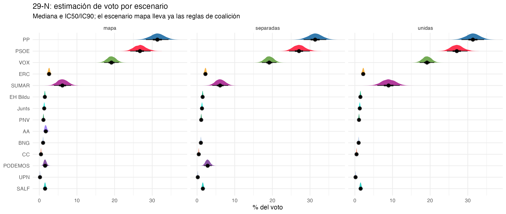
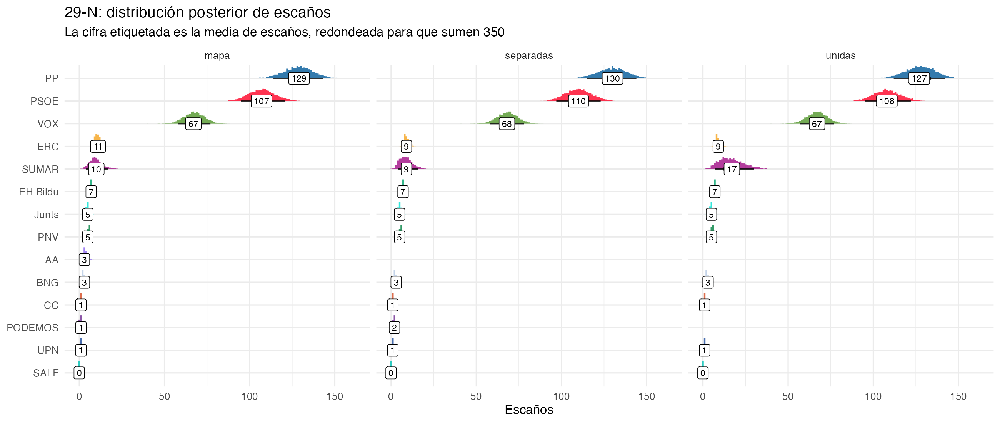
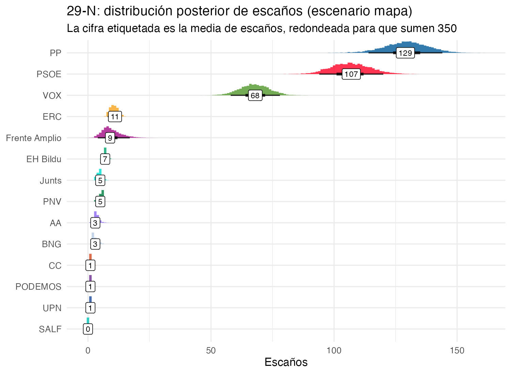
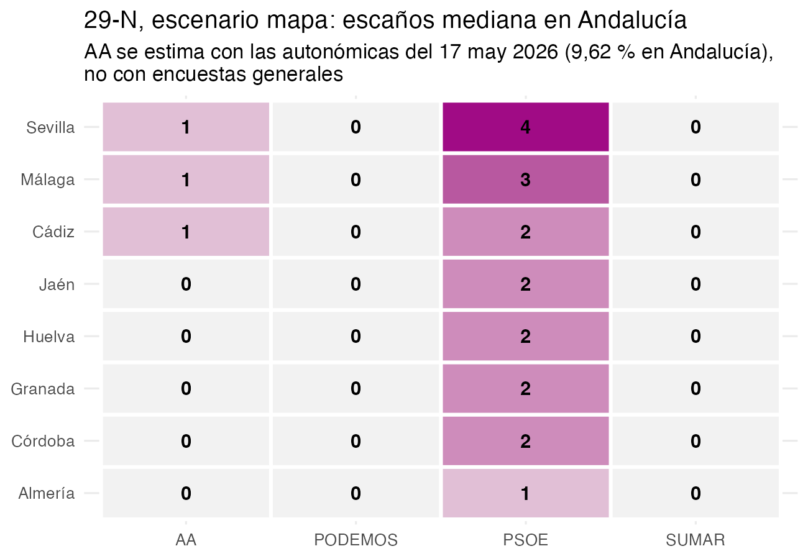

<!-- Los datos salen de los CSV que genera escenarios_mapa_29N.R en esta
     misma carpeta. Las cifras del texto son código R inline sobre esos CSV
     y sobre los argumentos por defecto de simular(). -->

```{r}
#| label: setup
#| include: false
#| message: false
library(readr)
library(dplyr)
library(tidyr)
library(purrr)
library(ggplot2)
library(here)

dir_fa <- here::here("2026/10/frente_amplio_y_adelante_andalucia")

# priors, sigmas y escaños por provincia: se leen del mismo código que corrió
# la simulación, no se copian a mano
sim_env <- new.env()
sys.source(here::here("2026/10/simular_escanos.R"), envir = sim_env)
fm <- formals(sim_env$simular)
pri <- list(
  cat = eval(fm$transfer_cat_alpha),
  aa_pct = eval(fm$aa_pct_and),
  aa_sd = eval(fm$aa_sd_logit),
  caniba = eval(fm$aa_caniba_alpha),
  sigma_bloque = eval(fm$sigma_bloque)
)
cat_pct <- 100 * pri$cat / sum(pri$cat)
caniba_pct <- 100 * pri$caniba / sum(pri$caniba)
aa_ic90 <- plogis(qlogis(pri$aa_pct) + c(-1, 1) * qnorm(0.95) * pri$aa_sd)

es <- function(x, d = 0) {
  format(
    round(x, d),
    nsmall = d,
    decimal.mark = ",",
    big.mark = ".",
    trim = TRUE
  )
}
pc <- function(x, d = 1) paste0(es(100 * x, d), " %")
# los votos de escenarios_29N_voto.csv ya están en %, no en proporción
pp <- function(x, d = 1) paste0(es(x, d), " %")
dec <- function(x) sub(".", ",", as.character(x), fixed = TRUE)
sg <- function(x, d = 1) {
  ifelse(
    x > 0,
    paste0("+", es(x, d)),
    sub("-", "\u2212", es(x, d), fixed = TRUE)
  )
}

leer <- function(f) {
  read_csv(file.path(dir_fa, f), show_col_types = FALSE) |>
    mutate(across(any_of("escenario"), \(x) recode(x, mapa = "oficial")))
}
t_esc <- leer("escenarios_29N_escanos.csv")
t_may <- leer("escenarios_29N_mayorias.csv")
t_blq <- leer("escenarios_29N_bloques.csv")
t_trn <- leer("escenarios_29N_transicion.csv")
t_vot <- leer("escenarios_29N_voto.csv")
t_prv <- leer("escenarios_29N_provincias.csv")
t_sen_e <- leer("sensibilidad_29N_escanos.csv")
t_sen_m <- leer("sensibilidad_29N_mayorias.csv")

# una sola fila que cumpla todas las condiciones (si no, falla)
lk <- function(tab, col, ...) {
  cond <- list(...)
  fila <- Reduce(`&`, Map(\(k, v) tab[[k]] == v, names(cond), cond))
  stopifnot(sum(fila) == 1)
  tab[[col]][fila]
}
sc <- c(oficial = "mapa", unidas = "unidas", separadas = "separadas")
em <- function(p, s = "oficial") {
  lk(t_esc, "mediana", partido = p, escenario = s)
}
ea <- function(p, s = "oficial") {
  lk(t_trn, paste0("media_", sc[[s]]), partido = p)
}
dif <- function(p) lk(t_trn, "dif_mapa_unidas", partido = p)
bq <- function(b, s = "oficial", col = "mediana") {
  lk(t_blq, col, bloque = b, escenario = s)
}
pr <- function(m, s = "oficial") lk(t_may, "prob", mayoria = m, escenario = s)
vt <- function(p, s = "oficial") {
  lk(t_vot, "mediana", partido = p, escenario = s)
}
pv <- function(prov, f, s = "oficial", col = "voto_mediana") {
  lk(t_prv, col, provincia = prov, partido = f, escenario = s)
}

v_base <- "base (aa 9,62 %, caniba 4,4,1)"
v_aa <- "aa_pct_and = 0,06"
v_can <- "caniba_alpha = (3, 3, 3)"
sn <- function(v, p) lk(t_sen_e, "mediana", variante = v, partido = p)
sm <- function(v, m) lk(t_sen_m, "prob", variante = v, mayoria = m)

# encuestas y errores
meta_1 <- read_csv(
  here::here("2026/10/encuestas_meta_grande_sep.csv"),
  show_col_types = FALSE
)
meta_2 <- read_csv(
  here::here("2026/10/encuestas_meta_bloque.csv"),
  show_col_types = FALSE
)
n_enc_1 <- n_distinct(meta_1$encuestadora, meta_1$fecha)
n_enc_2 <- n_distinct(meta_2$encuestadora, meta_2$fecha)
ult_enc <- max(meta_1$fecha)
errv <- read_csv(
  here::here("2026/10/errores_encuestas_ventana.csv"),
  show_col_types = FALSE
)
n_cal <- errv |>
  filter(dias <= 7) |>
  distinct(eleccion, casa, fecha) |>
  nrow()
sig_rng <- range(sim_env$error_sigma[c("PP", "PSOE", "VOX", "SUMAR")])
mu_psoe <- sim_env$error_mu[["PSOE"]]
mu_psoe_sin <- mu_psoe / sim_env$kappa_mu
rho_pv <- sim_env$R_error["PP", "VOX"]

# AA en las autonómicas de mayo
aa <- read_csv(
  here::here("2026/10/aa_autonomicas2026_provincias.csv"),
  show_col_types = FALSE
)
aa_share <- sum(aa$votos_aa) / sum(aa$votos_validos)
aa_escanos <- sum(aa$escanos_aa)
aa_pct_sev <- aa$pct_aa[aa$provincia == "Sevilla"]

# mapa y provincias
n_prov <- nrow(sim_env$prov_ref)
dip <- sim_env$escanos_29n
andal <- c(
  "Almería",
  "Cádiz",
  "Córdoba",
  "Granada",
  "Huelva",
  "Jaén",
  "Málaga",
  "Sevilla"
)
cat_prov <- c("Barcelona", "Tarragona", "Girona", "Lleida")
resto_sep <- sapply(andal, \(p) pv(p, "RESTO", "separadas"))
resto_0_of <- sum(sapply(andal, \(p) pv(p, "RESTO") == 0))
pod_0_of <- sum(sapply(andal, \(p) pv(p, "PODEMOS") == 0))
aa_con <- andal[sapply(andal, \(p) {
  pv(p, "AA", "oficial", "escanos_mediana") > 0
})]
fa_and_of <- sum(sapply(andal, \(p) {
  pv(p, "SUMAR", "oficial", "escanos_mediana")
}))
fa_and_un <- sum(sapply(andal, \(p) {
  pv(p, "SUMAR", "unidas", "escanos_mediana")
}))
psoe_and <- function(s) {
  sum(sapply(andal, \(p) pv(p, "PSOE", s, "escanos_mediana")))
}
suma_cat <- function(f, s) {
  sum(sapply(cat_prov, \(p) pv(p, f, s, "escanos_mediana")))
}

# totales de cambio entre escenarios (media de escaños, draw a draw)
resto_cambio <- c("PNV", "EH Bildu", "BNG", "Junts", "CC", "UPN")
dif_fa <- dif("SUMAR")
dif_aa_erc_pod <- dif("AA") + dif("ERC") + dif("PODEMOS")
dif_pp_vox <- dif("PP") + dif("VOX")
```

::: callout-note
## Actualización del 26 de octubre de 2026

Entran las tres encuestas nuevas de ciento76. La de SocioMétrica entra en el modelo de 7 categorías; Sigma Dos y NC Report no. Podemos anuncia que va dentro de la lista del Frente Amplio en Illes Balears, según elDiario, y lo cambio en el mapa con la regla `unida`, como en Canarias. Con eso, SUMAR saca `r pv("Illes Balears", "SUMAR", "oficial", "escanos_mediana")` escaño en Baleares en el escenario mapa, frente a `r pv("Illes Balears", "SUMAR", "separadas", "escanos_mediana")` con Podemos aparte. En el mapa, el PP tiene una mediana de `r em("PP")` escaños y VOX de `r em("VOX")`, y la probabilidad de que PP y VOX sumen 176 o más es `r pc(pr("PP + VOX >= 176"))`. La tabla de sensibilidad a los priors sigue siendo la del 17 de octubre.
:::

::: callout-note
## Actualización del 25 de octubre de 2026

Los tres escenarios usan los modelos reajustados con la encuesta de IMOP para El Confidencial (campo del 13 al 16 de octubre), la única publicada desde el 11 de octubre. En el escenario mapa, la mediana de escaños pasa de 131 a 129 para el PP y de 67 a 68 para VOX. La probabilidad de que PP y VOX sumen 176 o más sigue en el 99 %. La tabla de sensibilidad a los priors es todavía la del ajuste del 17 de octubre.
:::

## Resumen

Tercera parte del meta-análisis de las generales del **29 de noviembre de 2026**. En la [primera](https://muestrear-no-es-pecado.es/2026/10/meta-analisis-generales-jlcr/) agregué las encuestas y en la [segunda](https://muestrear-no-es-pecado.es/2026/10/meta-analisis-generales-escanos-jlcr/) traduje los porcentajes a escaños. 

Pero el 16 de octubre tuvimos coaliciones. Sumar ha hecho frente amplio, pero Podemos solo entra en algunas provincias, en Cataluña hace campaña por ERC y en Andalucía Adelante Andalucía compite fuera. Metemos eso en el simulador de escaños y comparamos con los dos extremos teóricos: lista conjunta en las `r n_prov` provincias (`unidas`) y listas separadas en las mismas (`separadas`).


Con las coaliciones actuales, que llamaremos escenario  (`oficial`) el Frente Amplio saca `r em("SUMAR")` escaños de mediana y Podemos `r em("PODEMOS")`. Si hubieran ido unidos en toda España serían `r em("SUMAR", "unidas")`; por separado en toda España, `r em("SUMAR", "separadas")` y `r em("PODEMOS", "separadas")`. La fragmentación le cuesta al Frente Amplio `r es(abs(dif_fa), 1)` escaños de media frente a la lista única. ERC gana con el mapa: pasa de `r em("ERC", "unidas")` a `r em("ERC")` escaños. Y Adelante Andalucía saca `r em("AA")`, que me sorprendió: la explicación está en las asunciones que he hecho, y las cuento abajo.


## De la encuesta al escaño

En [este post](https://muestrear-no-es-pecado.es/2026/10/meta-analisis-generales-escanos-jlcr/), conté como hacía la proyección de voto a escaños, con todos los caveats que pueda haber a

- Las encuestas informan de los grandes y, de vez en cuando, de los regionales. Como el mapa necesita escaños para ERC, Junts, PNV y compañía, hay un modelo aparte para el BLOQUE.
- Lo que dicen las encuestas no es lo que saldrá el 29-N: hay una capa de error calibrada con lo que se equivocaron de verdad entre 20D y 23J.
- Y el Congreso se reparte provincia a provincia, no a nivel nacional: hay un paso intermedio de distribución provincial.

El flujo completo sería (todo en `2026/10/`,
script: [`escenarios_mapa_29N.R`](https://github.com/joscani/blog_quarto/blob/master/2026/10/frente_amplio_y_adelante_andalucia/escenarios_mapa_29N.R)):


En dibujito 

```{mermaid}
%%| label: fig-pipeline-completo
%%| fig-cap: "El pipeline completo: encuestas -> posteriores -> error -> provincia -> mapa -> D'Hondt."
flowchart TD
  A[1. Encuestas<br/>scraping + preparar_meta] --> B["2. Modelo 1 (brms)<br/>multinomial 6/7 categorías<br/>time + (1|encuestadora)"]
  B --> C[3. Modelo 2<br/>composición del BLOQUE<br/>8 subceldas regionales]
  B --> D[4. Capa de error de encuestas<br/>calibrada 20D-23J]
  C --> D
  D --> E[5. Reparto provincial<br/>ratio 23J x shock jerárquico]
  E --> F[6. Reglas del mapa<br/>unida / sin_podemos / con_aa]
  F --> G["7. Umbral 3% + D'Hondt<br/>provincia a provincia"]
  G --> H[8. Resúmenes<br/>escaños, mayorías, provincias]
```

1. **Encuestas** ([`preparar_meta.R`](https://github.com/joscani/blog_quarto/blob/master/2026/10/preparar_meta.R), con actualización opcional de las
   encuestas del día). Tres datasets: el grande con 6 categorías (SUMAR =
   Sumar+Podemos, como la historia), el grande con 7 (SUMAR y PODEMOS
   separadas) y el del BLOQUE con sus subceldas. CIS y ElectoPanel fuera
   del modelo 1 (estimación y panel, respectivamente); el CIS quedará para
   un análisis aparte con microdatos. El modelo 1 usa `r n_enc_1` encuestas
   (la más reciente es del `r format(ult_enc, "%d/%m/%Y")`) y el modelo 2,
   `r n_enc_2`.

2. **Modelo 1** (`ajustar_grande` / `ajustar_grande_sep`): multinomial
   `cell_counts | trials(n) ~ time + (1 | encuestadora)`, con origen
   `2026-07-01` y predicción al 29-N con `re_formula = NA` (tendencia sin
   efecto casa: el sesgo común del consenso lo lleva la capa de error, no
   un efecto aleatorio nuevo).

3. **Modelo 2** (`ajustar_bloque`): multinomial condicional de 8 subceldas
   (Junts, ERC, PNV, EH Bildu, BNG, CC, UPN, RESTO) con `trials =` el n
   del BLOQUE de cada encuesta; solo casas que reportan los 7 regionales.

4. **Capa de error de encuestas**: empírica, calibrada con la última
   semana de campaña de 20D-2015 a 23J-2023 (`r n_cal` encuestas): sigma por
   partido (`r es(sig_rng[1], 1)`-`r es(sig_rng[2], 1)` pp.  sesgo del PSOE
   (+`r es(mu_psoe_sin, 2)` encogido a +`r es(mu_psoe, 2)`), correlación PP-VOX +`r es(rho_pv, 1)`

5. **Distribución provincial**: cuota nacional de cada simulación (un *draw* de la posterior) × ratio provincial
   del 23J × shock jerárquico `exp(eta_ccaa + eps_prov)`, con taus del
   posterior brms para los grandes, RMS de los grandes para SALF (y ahora
   AA) y plug-in para los regionales; cada multiplicador se recentra con
   los votos de la referencia para no despegar el voto nacional.

6. **Reglas del mapa**: las asunciones que hacemos tras la nueva configuración de las coaliciones electorales.

7. **Umbral legal del 3% provincial y D'Hondt** provincia a provincia; el
   RESTO agregado no compite (sus escaños "fantasma" se dan por perdidos).

8. **Resúmenes**: mediana e IC90 por partido y escenario, P(mayoría ≥ 176)
   y medianas de voto/escaños por provincia, en tres CSV.

::: {.callout-note}
## El pipeline es reproducible con encuestas nuevas

Cada ejecución descarga las encuestas que hayan salido desde la anterior, reconstruye los tres datasets, reajusta los tres
modelos y vuelve a simular todo: los resultados del post son una foto de la fecha
de la última ejecución. `--sin-actualizar` salta la descarga (por ejemplo,
para volver a simular sin encuestas nuevas).
:::

## El mapa de coaliciones, provincia a provincia

Lo que se ha registrado (CSV provisional del 16-17 oct, con Baleares del 26 oct): Sumar ha hecho
frente amplio, pero Podemos solo entra en algunas provincias; en Cataluña
Podemos no se presenta y hace campaña por ERC; en Andalucía, Adelante
Andalucía no entra en el frente amplio. El mapa operativo queda así:

- **Canarias, C. Valenciana e Illes Balears**: lista conjunta (Podemos dentro). En Baleares, Podemos se incorpora a la coalición Ara Més-Front Ampli (elDiario, 26 de octubre), y su coordinadora, Lucía Muñoz, va como independiente en el tercer puesto.
- **Cataluña**: Frente Amplio–Comuns por un lado; ERC + Podemos por otro
  (Podemos no compite con siglas propias).
- **Andalucía**: Frente Amplio por Andalucía sin Podemos ni Adelante
  Andalucía, que compite sola; Podemos se presenta aparte (candidatura sin
  nombre confirmado), y la canibalización de AA le deja un residuo mínimo.
- **Resto**: Podemos y el frente amplio por separado.

```{r}
#| label: tbl-mapa
#| tbl-cap: "Regla del simulador por comunidad: número de provincias (mapa provisional, 16-26 oct 2026)."
# el mismo fichero que lee simular(listas = "mapa")
mapa <- read_csv(
  here::here("2026/10/coaliciones_izquierda_29N_provincias.csv"),
  col_types = cols(.default = col_character())
)

mapa |>
  mutate(
    diputados = as.numeric(diputados),
    ccaa = recode(
      ccaa,
      "Asturias, Principado de" = "Asturias",
      "Balears, Illes" = "Illes Balears",
      "Comunitat Valenciana" = "C. Valenciana",
      "Madrid, Comunidad de" = "Madrid",
      "Murcia, Región de" = "Murcia",
      "Navarra, Comunidad Foral de" = "Navarra",
      "Rioja, La" = "La Rioja"
    )
  ) |>
  summarise(
    comunidades = paste(sort(unique(ccaa)), collapse = ", "),
    provincias = n(),
    diputados = sum(diputados),
    .by = regla
  ) |>
  mutate(
    regla = recode(
      regla,
      "unida" = "Lista conjunta (Podemos dentro)",
      "sin_podemos" = "Podemos con ERC",
      "con_aa" = "Con Adelante Andalucía",
      "separadas" = "Listas separadas"
    ),
    regla = factor(
      regla,
      c(
        "Lista conjunta (Podemos dentro)",
        "Podemos con ERC",
        "Con Adelante Andalucía",
        "Listas separadas"
      )
    )
  ) |>
  arrange(regla) |>
  mutate(across(regla, as.character)) |>
  select(regla, comunidades, provincias, diputados)
```

## Cómo entra el mapa en el simulador

El simulador ([`simular_escanos.R`](https://github.com/joscani/blog_quarto/blob/master/2026/10/simular_escanos.R)) reparte, en cada simulación, el voto nacional del posterior provincia a provincia (ratio 23J + shock jerárquico)
y aplica el umbral del 3% y D'Hondt con el reparto de escaños 

**regla por provincia**, después del reparto y antes del umbral:

```{mermaid}
%%| label: fig-pipeline
%%| fig-cap: "Dónde se aplica el mapa de coaliciones en la simulación."
flowchart TD
  A[Posterior del meta-análisis<br/>voto nacional de cada simulación] -->
  B[Reparto provincial<br/>ratio 23J + shock jerárquico] -->
  C[Regla provincial<br/>unida / sin_podemos / con_aa / separadas] -->
  D[Umbral 3% + D'Hondt] -->
  E[Escaños por provincia y partido]
```

- `unida` (Canarias, C. Valenciana, Illes Balears): el voto de Podemos se suma a la lista
  conjunta, D'Hondt no ve composición interna.
- `sin_podemos` (Cataluña): Podemos no compite; su voto se reparte entre
  ERC y SUMAR y el resto va a abstención/otros.
- `con_aa` (Andalucía): entra AA, con su propio patrón provincial.
- `separadas`: nada cambia.

## Adelante Andalucía. De residuo del modelo a partido con entidad propia

En el modelo 1 AA no existe: las encuestas que la cuentan la meten en el
BLOQUE, y el modelo 2 la deja dentro de RESTO, el residual del residual.
En el 23J eso era inofensivo (solo se presentó en Cádiz, 1,44%), pero en
las autonómicas de mayo sacó **`r pc(aa_share, 2)` y `r aa_escanos` escaños**, por delante de Por
Andalucía. Dejarla en un residual sin escaños infravaloraba a la izquierda
andaluza.

AA entra ahora teniendo en cuenta que:

1. **Patrón provincial** de las autonómicas del 17-may-2026
   (`aa_autonomicas2026_provincias.csv`). Es un multiplicador, no una
   distribución: share provincial = share andaluza de AA × (pct AA en la
   provincia / pct AA andaluz). El agregado ponderado por votos válidos
   reconstruye la cuota andaluza exactamente.

```{r}
#| label: tbl-patron-aa
#| tbl-cap: "Resultado de AA en las autonómicas de mayo 2026 (fuente: Demócrata)."
read_csv(
  here::here("2026/10/aa_autonomicas2026_provincias.csv"),
  show_col_types = FALSE
)
```

2. **De dónde sale su porcentaje**: primero del RESTO de la provincia (su "familia" de partidos
   actual en el modelo, que no compite en D'Hondt) y después de PODEMOS,
   SUMAR y PSOE — las papeletas que canibaliza — con pesos sorteados
   (`r es(caniba_pct[["PODEMOS"]])`/`r es(caniba_pct[["SUMAR"]])`/`r es(caniba_pct[["PSOE"]])` de media, ver la tabla de priors). Si a alguno de los tres no
   le queda voto que ceder, lo que falta sale del PSOE: pasa donde AA es
   grande y RESTO + SUMAR + Podemos es pequeño, como en Sevilla (AA `r es(100 * aa_pct_sev, 1)` % en
   mayo). Es una asunción gorda, lo sé.

3. **Umbral y D'Hondt normales**: compite como cualquier otra lista.

## La capa bayesiana de los supuestos nuevos

Todo lo demás en la simulación es Monte Carlo sobre posteriores; meter
estos supuestos como constantes congelaba la incertidumbre y los IC90
infravaloraban el riesgo total. Ahora cada simulación sortea:

| Supuesto | Prior | Media | IC90 implícito |
|---|---|---|---|
| Cuota andaluza de AA | logit-normal, sd `r es(pri$aa_sd, 1)` en logit | `r pc(pri$aa_pct, 2)` (mediana) | `r pc(aa_ic90[1])`-`r pc(aa_ic90[2])` |
| Patrón provincial de AA | shock provincial log-ratio con el tau provincial heredado de los grandes (como SALF) | patrón de mayo | — |
| Canibalización (Podemos/Sumar/PSOE) | Dirichlet(`r paste(dec(pri$caniba), collapse = ", ")`) | `r paste(round(caniba_pct), collapse = "/")` | — |
| Transferencia catalana (ERC/Sumar/fuera) | Dirichlet(`r paste(dec(pri$cat), collapse = ", ")`) | `r paste(es(cat_pct, 1), collapse = " / ")` | — |

El shock del patrón de AA solo mueve el reparto entre provincias

Los cuatro priors son elecciones explícitas, **la mayoría a ojo**; los nombro
uno a uno.

- **Cuota andaluza de AA** (logit-normal, sd `r es(pri$aa_sd, 1)` en logit): la mediana es
  el `r pc(aa_share, 2)` de las autonómicas de mayo, la única medición real que hay de
  AA. La sd es una elección a ojo con margen generoso: el IC90 va del `r pc(aa_ic90[1])`
  al `r pc(aa_ic90[2])`, un rango que cubre desde un AA que en generales se queda en
  dos tercios del voto autonómico hasta uno que lo supera con holgura. Lo
  incierto es el traslado autonómicas → generales (lista distinta, campaña
  nacional, participación), y prefiero pasarme de incertidumbre a
  congelarla en una constante.
- **Patrón provincial de AA**: lleva el mismo shock jerárquico que SALF,
  la otra familia sin encuestas propias, con el tau provincial heredado de
  los grandes. El shock se recentra para que solo mueve el reparto entre provincias y no cambie el total de Andalucía.
- **Canibalización** (Dirichlet(`r paste(dec(pri$caniba), collapse = ", ")`)): los pesos medios
  `r paste(round(caniba_pct), collapse = "/")` reflejan de dónde salió el voto de AA en las autonómicas: compite en el
  mismo espacio que Podemos y Sumar, y solo toca al PSOE cuando la suma de
  los otros dos no llega para compensar lo que se estima que debe sacar AA. Con suma `r sum(pri$caniba)`, la Dirichlet deja dispersión entre simulaciones:
  a veces AA come más de Podemos, a veces más de Sumar.
- **Transferencia catalana** (Dirichlet(`r paste(dec(pri$cat), collapse = ", ")`)): el reparto medio
  `r es(cat_pct[["ERC"]], 1)` / `r es(cat_pct[["SUMAR"]], 1)` / `r es(cat_pct[["fuera"]], 1)` es un criterio a ojo anclado en la campaña: Podemos pide
  explícitamente el voto para ERC, pero parte de su electorado tiene lista
  propia en el FA-Comuns.

::: {.callout-note}
## El matiz del doble conteo

Si AA ya está parcialmente dentro del BLOQUE/RESTO que miden las encuestas,
dibujarle encima una share andaluza de ~`r pc(aa_share, 1)` implica asumir que las
encuestas nacionales la infravaloran.
:::

## Resultados

```{r}
#| label: tbl-escanos
#| tbl-cap: "Escaños por partido y escenario (mediana e IC90). `oficial` es el mapa de coaliciones registrado el 16-17 oct, con Baleares del 26 oct."
protagonistas <- c("SUMAR", "PODEMOS", "AA", "ERC", "PSOE", "PP", "VOX")
t_esc |>
  filter(partido %in% protagonistas) |>
  mutate(
    celda = paste0(round(mediana), " [", round(q05), ", ", round(q95), "]"),
    partido = factor(partido, protagonistas)
  ) |>
  pivot_wider(
    id_cols = partido,
    names_from = escenario,
    values_from = celda
  ) |>
  arrange(partido) |>
  mutate(
    across(oficial:unidas, ~ ifelse(is.na(.x), "—", .x)),
    across(partido, as.character)
  ) |>
  select(partido, unidas, separadas, oficial)
```

```{r}
#| label: tbl-mayorias
#| tbl-cap: "Probabilidad de cada mayoría por escenario. Investidura = PSOE, Frente Amplio, Podemos, AA, ERC, Junts, EH Bildu, PNV, BNG y CC."
t_may |>
  mutate(
    mayoria = recode(mayoria, "izquierda >= 176" = "investidura >= 176"),
    prob = pc(prob)
  ) |>
  select(escenario, mayoria, prob)
```

{#fig-voto}

{#fig-escanos}

{#fig-escanos-mapa}

{#fig-andalucia}


### ¿Cuánto cuesta las coaliciones acordadas?

Los tres escenarios comparten modelo, simulaciones y semilla; solo cambia la regla
provincial. Por eso la diferencia simulación a simulación entre dos escenarios es el
efecto de las coaliciones acordadas, sin ruido de simulación entre ellos.

El mismo voto rinde menos en dos listas que en una. Sumar y Podemos suman
`r pp(vt("SUMAR", "unidas"))` del voto nacional (mediana) tanto juntos (`unidas`) como por
separado en toda España (`separadas`: `r pp(vt("SUMAR", "separadas"))` + `r pp(vt("PODEMOS", "separadas"))`). Juntos sacan `r em("SUMAR", "unidas")` escaños de mediana; por separado, `r em("SUMAR", "separadas")` + `r em("PODEMOS", "separadas")`. El mapa real queda en `r em("SUMAR")` + `r em("PODEMOS")`: para
el Frente Amplio y Podemos se parece más a `separadas` que a `unidas`.

Ningún escaño se pierde: D'Hondt reparte siempre los 350. Al pasar de
`unidas` al `oficial`, el FA pierde `r es(abs(dif_fa), 1)` escaños de media; AA, ERC y Podemos
recogen `r es(dif_aa_erc_pod, 1)` y PP y VOX, `r es(dif_pp_vox, 1)`.

```{r}
#| label: tbl-transicion
#| tbl-cap: "Escaños medios por partido en `unidas` y `oficial`, y cambio draw a draw (oficial − unidas)."
tr_fila <- function(ps) {
  tibble(
    unidas = sum(sapply(ps, \(p) ea(p, "unidas"))),
    oficial = sum(sapply(ps, \(p) ea(p, "oficial"))),
    cambio = sum(sapply(ps, dif))
  )
}
grupos <- list(
  "Frente Amplio (SUMAR)" = "SUMAR",
  "AA" = "AA",
  "ERC" = "ERC",
  "Podemos" = "PODEMOS",
  "PP" = "PP",
  "VOX" = "VOX",
  "PSOE" = "PSOE",
  "PNV, EH Bildu, BNG, Junts, CC y UPN" = resto_cambio
)
imap_dfr(grupos, \(ps, nom) {
  tr_fila(ps) |> mutate(partido = nom, .before = 1)
}) |>
  mutate(
    unidas = es(unidas, 1),
    oficial = es(oficial, 1),
    cambio = sg(cambio)
  ) |>
  rename(
    Partido = partido,
    `unidas (escaños, media)` = unidas,
    `oficial (escaños, media)` = oficial,
    `Cambio (escaños)` = cambio
  )
```

**Método**: `escenarios_29N_transicion.csv`; cambio = media sobre los 6.000
simulaciones de (escaños en `oficial` − escaños en `unidas`). Los cambios suman 0.

Para los grandes, el efecto es pequeño frente a la incertidumbre
del posterior. La probabilidad de la mayoría de PP + VOX se mueve entre el
`r pc(pr("PP + VOX >= 176", "unidas"))` y el `r pc(pr("PP + VOX >= 176", "separadas"))`.

```{r}
#| label: tbl-bloques
#| tbl-cap: "Escaños medianos de PP, PSOE y de los bloques, y probabilidad de mayoría, por escenario."
fila_esc <- function(s) {
  c(
    em("PP", s),
    em("VOX", s),
    em("PSOE", s),
    bq("derecha", s),
    bq("izquierda", s),
    pc(pr("PP + VOX >= 176", s)),
    pc(pr("izquierda >= 176", s))
  )
}
tibble(
  Indicador = c(
    "PP (escaños, mediana)",
    "VOX (escaños, mediana)",
    "PSOE (escaños, mediana)",
    "PP + VOX (escaños, mediana)",
    "Investidura (escaños, mediana)",
    "P(PP + VOX ≥ 176)",
    "P(investidura ≥ 176)"
  ),
  unidas = fila_esc("unidas"),
  oficial = fila_esc("oficial"),
  separadas = fila_esc("separadas")
)
```

"Investidura" es el bloque de los grupos que apoyaron a Sánchez en 2023,
más Podemos y AA: PSOE, Frente Amplio, Podemos, AA, ERC, Junts, EH Bildu,
PNV, BNG y CC. **Método**: `escenarios_29N_bloques.csv`; mediana y
P(≥ 176) de la suma de escaños por simulación.

El bloque de investidura saca `r bq("izquierda", "unidas")` escaños de mediana en `unidas`, `r bq("izquierda", "oficial")` en el
`oficial` y `r bq("izquierda", "separadas")` en `separadas`. El mapa queda a medio camino gracias a la
transferencia catalana y a AA, que convierte en escaños voto que antes no
competía. El mapa no decide la elección entre bloques: decide cuántos
escaños pierde la izquierda compitiendo consigo misma.

### AA en Andalucía

Con el escenario `oficial`, AA saca `r em("AA")` escaños de mediana (`r es(ea("AA"), 1)` de media), con un escaño mediano en `r paste(aa_con, collapse = ", ")` (@fig-andalucia). Su voto mediano en esas
provincias es del `r pc(pv("Cádiz", "AA"))`, `r pc(pv("Sevilla", "AA"))` y `r pc(pv("Málaga", "AA"))`.

AA vacía primero el RESTO (del `r pc(min(resto_sep))` al `r pc(max(resto_sep))` provincial en
`separadas` a 0 en `r resto_0_of` de las ocho provincias) y después come de Podemos y Sumar. Podemos se queda
con voto mediano 0 en `r pod_0_of` de las ocho provincias. En Sevilla, el FA pasa
del `r pc(pv("Sevilla", "SUMAR", "separadas"))` en `separadas` al `r pc(pv("Sevilla", "SUMAR"))` en `oficial`, y Podemos del
`r pc(pv("Sevilla", "PODEMOS", "separadas"))` a `r pc(pv("Sevilla", "PODEMOS"))`. El Frente Amplio andaluz queda a
`r fa_and_of` escaños en las ocho provincias (`r fa_and_un` en `unidas`).

El coste para el PSOE es contenido: `r sg(vt("PSOE") - vt("PSOE", "unidas"), 1)` puntos de voto nacional frente a
`unidas` (`r pp(vt("PSOE", "unidas"))` → `r pp(vt("PSOE"))`, mediana). En escaños andaluces, la suma de
medianas provinciales del PSOE es `r psoe_and("unidas")` en `unidas`, `r psoe_and("oficial")` en `oficial` y `r psoe_and("separadas")` en `separadas`.
Parte de los escaños de AA sale de voto que antes no competía en D'Hondt.

### La transferencia catalana

ERC pasa de `r em("ERC", "unidas")` a `r em("ERC")` escaños de mediana con `oficial` (`r sg(dif("ERC"), 1)` de media, simulación a
simulación). Recoge de media el `r es(cat_pct[["ERC"]], 1)` % del voto catalán de Podemos; el `r es(cat_pct[["SUMAR"]], 1)` % va al Frente Amplio y el
`r es(cat_pct[["fuera"]], 1)` % sale del voto válido (abstención u otros). El
reparto se sortea en cada simulación con la Dirichlet.

En Cataluña, lo que gana ERC lo pierde el FA: ERC pasa de `r suma_cat("ERC", "unidas")` a `r suma_cat("ERC", "oficial")` escaños y el FA de
`r suma_cat("SUMAR", "unidas")` a `r suma_cat("SUMAR", "oficial")` (suma de medianas provinciales, `unidas` frente a `oficial`).
Es la pieza del mapa que no tiene coste de fragmentación para la
izquierda: el voto no se parte, cambia de lista.

```{r}
#| label: fig-cataluna
#| fig-cap: "Efecto de la transferencia catalana: voto mediano provincial de ERC y SUMAR en `separadas` y `oficial`, con el escaño mediano junto a cada punto."
t_prv |>
  filter(
    escenario %in% c("separadas", "oficial"),
    partido %in% c("ERC", "SUMAR"),
    provincia %in% cat_prov
  ) |>
  pivot_wider(
    id_cols = c(partido, provincia),
    names_from = escenario,
    values_from = c(voto_mediana, escanos_mediana)
  ) |>
  mutate(
    partido = factor(partido, c("ERC", "SUMAR")),
    provincia = factor(provincia, cat_prov),
    lab_sep = ifelse(
      escanos_mediana_separadas > 0,
      as.character(escanos_mediana_separadas),
      ""
    ),
    lab_map = ifelse(
      escanos_mediana_oficial > 0,
      as.character(escanos_mediana_oficial),
      ""
    )
  ) |>
  ggplot(aes(y = provincia)) +
  geom_segment(
    aes(
      x = voto_mediana_separadas,
      xend = voto_mediana_oficial,
      yend = provincia
    ),
    linewidth = 1.2,
    color = "grey75"
  ) +
  geom_point(aes(x = voto_mediana_separadas, color = "separadas"), size = 3) +
  geom_point(aes(x = voto_mediana_oficial, color = "oficial"), size = 3) +
  geom_text(
    aes(x = voto_mediana_separadas, label = lab_sep),
    hjust = 1.4,
    size = 3,
    color = "grey30"
  ) +
  geom_text(
    aes(x = voto_mediana_oficial, label = lab_map),
    hjust = -0.4,
    size = 3,
    color = "grey30"
  ) +
  facet_wrap(~partido) +
  scale_x_continuous(labels = \(x) paste0(round(100 * x, 1), " %")) +
  labs(x = "Voto mediano por provincia", y = NULL, color = NULL) +
  theme_bw(base_size = 12)
```

## Sensibilidad

Los priors nuevos son parámetros de `simular()`, así que la sensibilidad no
exige reajustar modelos: vuelvo a ejecutar el escenario `oficial` con la misma
semilla y el mismo posterior, cambiando un prior cada vez. Dos variantes:
una share andaluza de AA más floja (`aa_pct_and = 0,06`) y una
canibalización repartida a partes iguales (`aa_caniba_alpha = (3, 3, 3)`),
con la que AA también come del PSOE.

```{r}
#| label: tbl-sensibilidad
#| tbl-cap: "Sensibilidad del escenario oficial a los priors de AA (mediana e IC90 de escaños). La base es la ejecución del post."
t_sen_e |>
  mutate(
    celda = paste0(round(mediana), " [", round(q05), ", ", round(q95), "]"),
    variante = recode(
      variante,
      "base (aa 9,62 %, caniba 4,4,1)" = "Base",
      "aa_pct_and = 0,06" = "AA al 6 %",
      "caniba_alpha = (3, 3, 3)" = "AA come también del PSOE"
    ),
    partido = factor(
      partido,
      c("AA", "SUMAR", "PODEMOS", "PSOE", "PP", "VOX", "ERC")
    )
  ) |>
  pivot_wider(id_cols = partido, names_from = variante, values_from = celda) |>
  arrange(partido) |>
  mutate(across(partido, as.character)) |>
  select(partido, Base, `AA al 6 %`, `AA come también del PSOE`)
```

Dos conclusiones. La share andaluza de AA mueve sobre todo a AA: con el
prior flojo, AA baja de `r sn(v_base, "AA")` a `r sn(v_aa, "AA")` escaño de mediana, y el resto de la tabla apenas
cambia (SUMAR `r sn(v_aa, "SUMAR")`, PODEMOS `r sn(v_aa, "PODEMOS")`, ERC `r sn(v_aa, "ERC")`; PP `r sn(v_aa, "PP")` y VOX `r sn(v_aa, "VOX")` igual que en la base, PSOE `r sn(v_aa, "PSOE")` frente a `r sn(v_base, "PSOE")`).
La pieza delicada es la canibalización: si AA come del PSOE al mismo nivel
que de Podemos y Sumar, el PSOE pierde unos `r sn(v_base, "PSOE") - sn(v_can, "PSOE")` escaños de mediana (`r sn(v_base, "PSOE")` → `r sn(v_can, "PSOE")`), VOX y PP ganan
`r sn(v_can, "VOX") - sn(v_base, "VOX")` y `r sn(v_can, "PP") - sn(v_base, "PP")` escaños respectivamente, P(PP + VOX ≥ 176) sube del `r pc(sm(v_base, "PP + VOX >= 176"))` al
`r pc(sm(v_can, "PP + VOX >= 176"))` y P(investidura ≥ 176) baja del `r pc(sm(v_base, "izquierda >= 176"))` al `r pc(sm(v_can, "izquierda >= 176"))`. El prior
Dirichlet(4, 4, 1), anclado en las autonómicas, es el que menos daño hace
a la izquierda por construcción: el escenario que de verdad duele es el
que no puedo descartar.

## Limitaciones

- AA no tiene posterior propio: su incertidumbre es el prior, no datos de
  encuestas generales.
- El patrón provincial de AA es el de unas autonómicas; el traslado a
  generales puede no ser uniforme.
- La capa de error de encuestas sigue calibrada con SUMAR agregado
  (historia); el split Podemos/Sumar hereda su incertidumbre del posterior
  del modelo separado.
- La sensibilidad acota el daño: los priors de AA no cambian el ganador
  (P(PP + VOX ≥ 176) entre `r pc(sm(v_base, "PP + VOX >= 176"))` y `r pc(sm(v_can, "PP + VOX >= 176"))`), pero sí el reparto interno de
  la izquierda: con canibalización a partes iguales el PSOE pierde `r sn(v_base, "PSOE") - sn(v_can, "PSOE")`
  escaños que el prior de las autonómicas le ahorra.

## Detalles técnicos

- 6.000 simulaciones por escenario; seed 2911 en las simulaciones, 7314 en los
  fits. Reajuste de los tres modelos en cada ejecución.
- Los tres escenarios usan el modelo 1 de 7 categorías (SUMAR y PODEMOS
  separadas) y la misma semilla; solo cambia la regla provincial (`unida`
  en las 52, `separadas` en las 52 o la registrada). Las simulaciones están
  emparejadas: la simulación k es el mismo resultado de las encuestas en los
  tres escenarios.
- Código: [`simular_escanos.R`](https://github.com/joscani/blog_quarto/blob/master/2026/10/simular_escanos.R) , [`preparar_meta.R`](https://github.com/joscani/blog_quarto/blob/master/2026/10/preparar_meta.R) (encuestas y datos de entrada) y [`escenarios_mapa_29N.R`](https://github.com/joscani/blog_quarto/blob/master/2026/10/frente_amplio_y_adelante_andalucia/escenarios_mapa_29N.R) . Los priors y las sigmas del texto se leen de `simular_escanos.R` con `formals()`, no se copian.
- Datos: los CSV de salida y los dos insumos del mapa y de AA están en la release [`frente-amplio-29n`](https://github.com/joscani/blog_quarto/releases/tag/frente-amplio-29n): `escenarios_29N_escanos.csv`, `escenarios_29N_mayorias.csv`, `escenarios_29N_bloques.csv`, `escenarios_29N_transicion.csv`, `escenarios_29N_provincias.csv`, `escenarios_29N_voto.csv`, `sensibilidad_29N_escanos.csv`, `sensibilidad_29N_mayorias.csv`, `coaliciones_izquierda_29N_provincias.csv` y `aa_autonomicas2026_provincias.csv`. La sensibilidad usa la misma semilla y posterior que la base, cambiando un prior cada vez.
