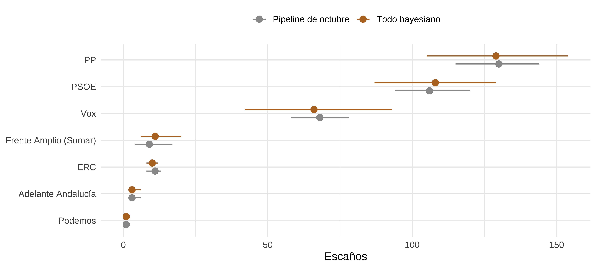
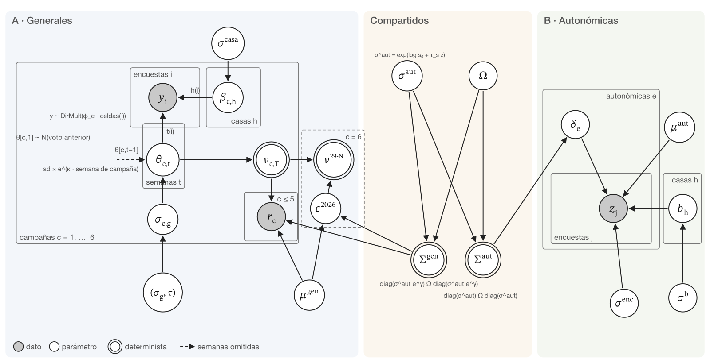
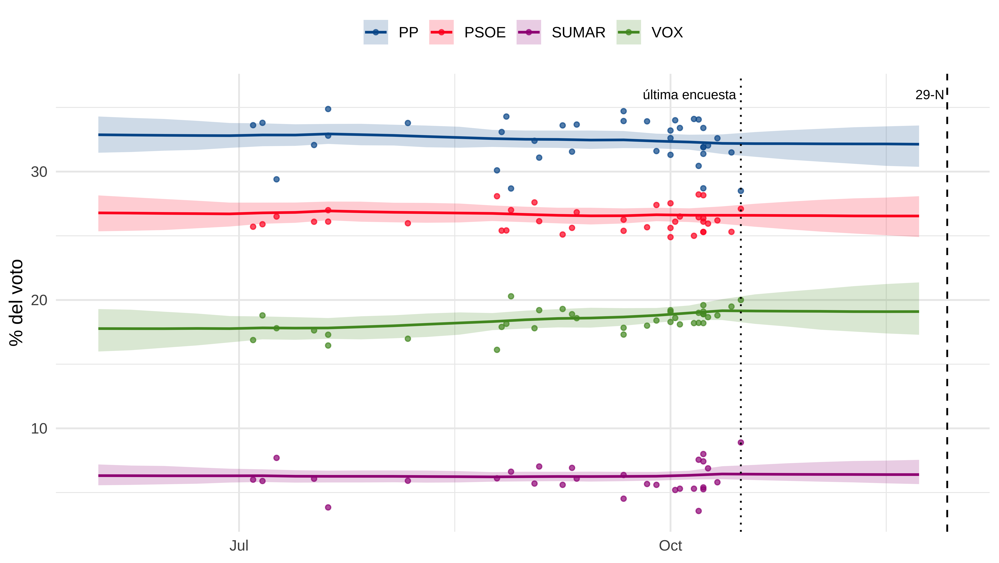
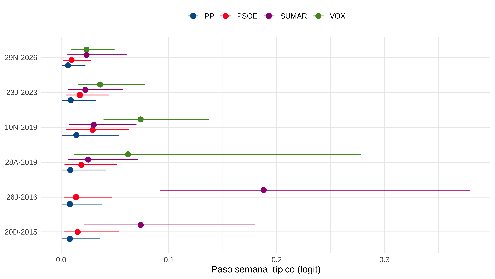
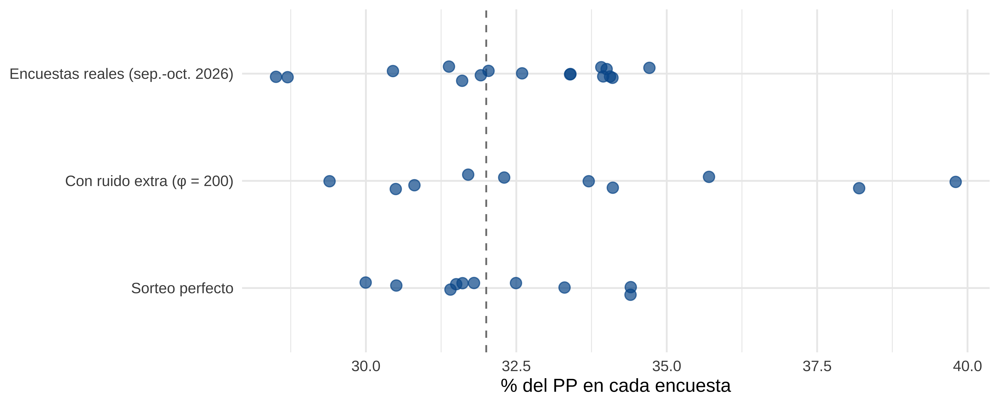
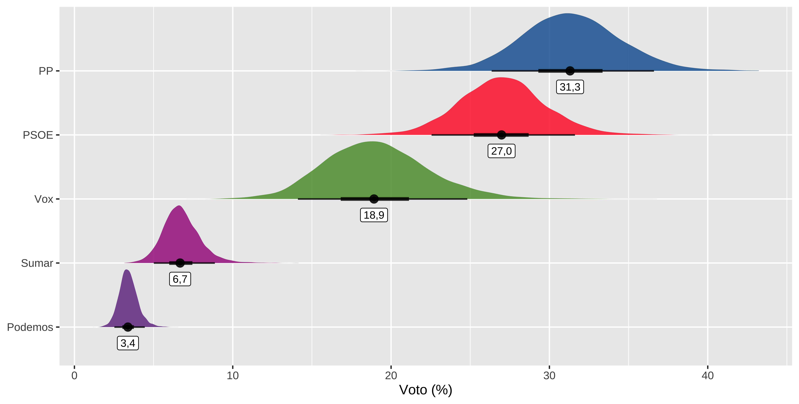

Esta es la versión corta. El post completo, con todo el código en R y el modelo de Stan, está en el blog: [Generales 2026, todo bayesiano (I): el voto](https://muestrear-no-es-pecado.netlify.app/2026/10/full-bayesian/full-bayesian). Los scripts y los datos para reproducirlo están enlazados allí.

## Por qué otro modelo

En el [metaanálisis](https://muestrear-no-es-pecado.netlify.app/2026/10/meta-analisis-generales-jlcr) estimaba el voto en dos pasos, con decisiones tomadas a ojo: el sesgo del PSOE, la correlación entre los fallos con el PP y con Vox, el error del bloque de partidos regionales. Aquí va todo junto **en un único modelo bayesiano**, y cada trozo de incertidumbre sale de un dato o de un prior que se puede discutir:

| Pieza | Posts anteriores | Aquí |
|---|---|---|
| Cuánto se mueve el voto hasta el día E | Tendencia lineal, extrapolada | Paseo aleatorio, con la volatilidad aprendida de seis campañas |
| Cuánto suelen fallar las encuestas | Desviaciones medidas en cinco generales, tratadas como conocidas | Estimado, con su propia incertidumbre |
| Sesgo del PSOE | +1,32 puntos, encogido a la mitad "a ojo" | Estimado con pooling |
| Correlación del error PP–Vox | +0,92 encogida a +0,5 "a ojo" | Aprendida de 44 elecciones |
| Error del bloque de partidos regionales | 1,5 puntos, un supuesto | Sin error propio: absorbe en proporción el ajuste de los grandes |

Los datos: 445 encuestas de las cinco campañas pasadas, 37 de 2026 con los grandes partidos, 100 con el desglose regional y 217 de la última semana en 39 elecciones autonómicas. Un solo posterior para todo.

## El resultado, de golpe

La media apenas se mueve respecto al pipeline de octubre (PP en 129 escaños frente a 130), pero **la horquilla se ensancha de lo lindo**: el PP pasa de 115–144 a 105–154, y la probabilidad de mayoría de PP y Vox baja del 98,8 % al 95,5 %.

| Versión | PP: mediana | IC90 | Ancho |
|---|---|---|---|
| Solo el voto latente (sin error) | 133 | 123–141 | 18 |
| Pipeline de octubre (error fijado a mano) | 130 | 115–144 | 29 |
| Todo bayesiano (error estimado) | 129 | 105–154 | 49 |

La horquilla más ancha no es timidez: es la incertidumbre que en los posts anteriores se fijaba a mano, ahora estimada a partir de cómo de equivocadas han ido las encuestas en el pasado. Y con una promesa concreta: si el modelo está bien calibrado, el resultado del 29-N cae dentro del intervalo 9 de cada 10 veces. Al final compruebo si lo cumple con un viaje al pasado.

## El modelo en una imagen

La idea: **todas las campañas generales funcionan igual**. Hay un voto que no vemos y que va cambiando semana a semana; las encuestas lo miden con su ruido y con las manías de cada casa; y el día de la votación el resultado es el que es. De las cinco generales anteriores conozco el resultado; de la de 2026, todavía no. Un solo modelo aprende de las seis a la vez: las encuestas informan del voto latente, y los resultados reales (más las autonómicas) enseñan al modelo cuánto se equivoca el consenso el día E.

El modelo completo, línea a línea y con sus priors, en el [post del blog](https://muestrear-no-es-pecado.netlify.app/2026/10/full-bayesian/full-bayesian).

## El voto latente: lo que diría la media de las casas

Cada semana hay un voto latente —lo que diría la media de las casas si encuestaran cada semana— que cambia un poco al azar: un **paseo aleatorio**. La incertidumbre crece con cada semana sin encuestas, y cuánto crece lo deciden los datos, no yo.

Desde la última encuesta (14 de octubre) hasta el 29-N el modelo solo puede extrapolar, y el intervalo se abre. Pero se abre despacio: en esta campaña el paso semanal del PP sale en torno a 0,01 en logit, unas décimas de punto. Por eso una encuesta de julio sigue pesando casi lo mismo que una de octubre: su información ha atravesado pocos pasos del paseo y no ha perdido mucha precisión. **No hace falta inventarse una vida media** ("una encuesta pierde la mitad de su peso cada dos semanas"): la pérdida la estima el modelo.

Lo que sí cambia mucho es el ritmo de cada campaña: cada una tiene su volatilidad, parecida a la de las demás pero no igual (el parámetro que mide cuánto difieren sale 0,79, con un intervalo que va de la mitad al doble). En el gráfico destacan el 26J-2016, cuando Podemos e IU se unieron a mitad de precampaña, y el 10N-2019, cuando Vox pasó del 10 % al 15 % en seis meses. La de 2026 es de las tranquilas —y eso, entre la última encuesta y el 29-N, es una suerte.

## Casas, ruido y rebaño

Una encuesta no se aparta del voto real solo por azar. Hay tres cosas mezcladas, y se distinguen por lo que comparten:

- Lo que **se repite en la misma casa** es el **efecto casa**: su método, su universo, cómo pondera. Es la "manía" de la casa, y no es el voto.
- Lo que **ven todas las casas la misma semana** es el **voto latente**.
- Lo que **no comparte nadie** es **ruido**: una encuesta suelta que a la semana siguiente vuelve a su sitio.

Lo que esta separación no puede ver es que todas las casas se equivoquen a la vez y siempre: para el modelo, eso es el voto. Ese error común del consenso solo se descubre el día de la votación —es la sección siguiente—.

Y las encuestas tampoco son urnas perfectas: si lo fueran, diez encuestas de 1.000 personas con un PP real del 32 % saldrían todas entre el 29 y el 35 %. El modelo usa una **Dirichlet-multinomial**: cada encuesta saca sus bolas de su propia urna, una copia algo movida de la de verdad, y cuánto se mueven las copias (φ) lo estima el modelo con la historia.

Lo que sale: en 2015, 2016 y abril de 2019 las encuestas iban cada una por su lado (φ entre 60 y 210). Desde noviembre de 2019, nada de ruido extra: φ pasa de las decenas de miles y las encuestas se comportan como sorteos perfectos. Mejor dicho, más que perfectas: en el PSOE y en Vox de 2026, las encuestas se separan entre sí **menos** de lo que permite el azar (el cociente entre la dispersión observada y la del sorteo puro es 0,46 y 0,53; 1 sería sorteo puro). Es el **rebaño**: las casas se miran unas a otras y no se alejan del consenso. La Dirichlet-multinomial no puede recogerlo —solo sabe añadir ruido, no quitarlo—, pero para la predicción no es grave: ese parecido entre casas es justo el error que cometen todas a la vez, y de eso se encarga la pieza siguiente.

## El error del consenso

Las encuestas solas no pueden saber si se equivocan todas juntas. Para medirlo hace falta la verdad: los resultados de las cinco generales pasadas, que entran en el modelo como un dato más. En cada una de esas campañas el modelo estima el voto latente semana a semana y lo compara con lo que salió de las urnas. De ahí aprende el sesgo, el tamaño y la correlación del error. Para 2026, el error no se observa: **se sortea** de esa misma distribución, un error distinto en cada una de las 6.000 simulaciones.

¿En qué escala? En **logit**, no en puntos: dos puntos no pesan lo mismo para un partido del 32 % que para uno del 3 %. En el 28A las encuestas daban al PP un 19,7 % y sacó un 16,7 % (3 puntos); en el 23J le daban un 34,2 % y sacó un 33,1 % (1,1 punto). En puntos, unas tres veces más; en logit, cuatro veces más. El logit pone a grandes y pequeños en la misma escala.

El error se mide contra el **voto latente** (la media de las casas, cada una con el mismo peso), no contra la media de las encuestas, donde la casa que más publica pesa más: contra una u otra media, el signo del sesgo puede cambiar.

Lo que aprende, convertido a puntos con el tamaño actual de cada partido:

| Partido | Sesgo típico | Tamaño típico del fallo |
|---|---|---|
| PP | −0,5 puntos | ~3 puntos |
| PSOE | +0,6 puntos | ~2,4 puntos |
| Vox | ~0 | ~2,7 puntos |
| Sumar + Podemos | +0,4 puntos | ~1,3 puntos |

Y la correlación entre los fallos, que es lo más interesante: **cuando las encuestas se pasan con el PP, se quedan cortas con Vox, y al revés** (correlación −0,50, decidida por los datos: contracción 0,87). Lo mismo con PSOE y Vox (−0,35). En cambio, los fallos con el PP y con el PSOE van cada uno por su lado (−0,01). Ojo: esto no dice que PP y Vox se peleen por los mismos votantes; dice que las encuestas se equivocan al **repartir** el voto entre los dos, aunque se acerquen más con la suma.

Las cinco generales son poca cosa para estimar todo eso, y ahí entran las **autonómicas**: 217 encuestas de la última semana en 39 elecciones, hechas por las mismas casas. No se mezclan a lo loco: comparten con las generales la correlación del error y el patrón de qué partidos se fallan más, pero no el nivel ni el sesgo. La conclusión principal: las generales no fallan apreciablemente más que las autonómicas (el parámetro que separa los dos niveles sale 0,04, prácticamente cero).

## El voto del 29-N

Es el voto latente de la última semana más el error sorteado, simulación a simulación (6.000 draws):

| Partido | Mediana (%) | IC90 (%) |
|---|---|---|
| PP | 31,3 | 26,4–36,6 |
| PSOE | 27,0 | 22,6–31,6 |
| Vox | 18,9 | 14,1–24,8 |
| Sumar | 6,7 | 5,0–8,9 |
| Podemos | 3,4 | 2,5–4,4 |

Con el mapa de listas del 29-N (Frente Amplio, Podemos con ERC en Cataluña, Adelante Andalucía) y la maquinaria de escaños de los posts anteriores, esto es lo que sale: **PP 129, PSOE 108, Vox 66, Frente Amplio (Sumar) 11** y un reparto que suma 350: 129, 108, 66, 12… PP y Vox suman 195 escaños de mediana (IC90: 176–215) y alcanzan la mayoría absoluta en el **95,5 %** de las simulaciones; la investidura de la izquierda, en el 3,5 %.

Las horquillas de cada partido son anchas —Vox, de 42 a 93 escaños—, y salen de dos sitios: lo que las encuestas fallan todas a la vez (unos tres puntos con el PP, según la historia) y las casi siete semanas sin encuestas hasta el 29-N. La de la suma PP + Vox es más estrecha en proporción, por la correlación negativa: cuando las encuestas fallan con uno, suelen fallar al revés con el otro.

## ¿Nos lo creemos?

Me puse en la víspera de cuatro generales (26J-2016, 28A-2019, 10N-2019 y 23J-2023) con solo lo que se sabía entonces, ajusté el modelo y miré dónde cayó el resultado real:

| Qué | Versión | Real dentro del IC90 | Posición del real (≈0,49 si está calibrado) | Ancho medio |
|---|---|---|---|---|
| Voto | Pipeline de octubre | 12 de 15 | 0,55 | 5,5 pp |
| Voto | Todo bayesiano | **14 de 15** | 0,50 | 7,3 pp |
| Escaños | Pipeline de octubre | 14 de 15 | 0,54 | 26 escaños |
| Escaños | Todo bayesiano | 14 de 15 | 0,43 | 35 escaños |

El modelo nuevo falla una vez —el PP del 28A: sacó 66 escaños y el modelo daba entre 70 y 97—, a cambio de horquillas más honestas. En voto está casi clavado en la calibración (posición media 0,50). Y en 2023, cuando casi todo el mundo daba por hecha la mayoría de PP y Vox, el modelo, con lo que se sabía la víspera, le habría dado un **46 %**: una moneda al aire. Sumaron 170.

Con cuatro elecciones, esto dice que el modelo no está mal calibrado, no que sea perfecto. Y hay algo que el backtest no puede probar: en las elecciones pasadas la última encuesta estaba a seis días de la votación; ahora quedan casi siete semanas. Esa parte de la horquilla se apoya en la volatilidad estimada, no en una validación.

## Los supuestos principales

| Supuesto | De dónde sale | ¿Puesto a prueba? |
|---|---|---|
| El voto latente es un paseo aleatorio, con volatilidad propia de cada campaña | Modelo | Sí: backtest |
| El consenso es la media de las casas, cada una con el mismo peso | Decisión | No |
| El error del consenso es normal en logit, con sesgo, tamaño y correlación | Modelo | Sí: backtest |
| Las autonómicas comparten con las generales la correlación y el patrón de los fallos | Decisión | En parte: contracción y backtest |
| Sin CIS ni ElectoPanel en los grandes partidos (ElectoPanel sí en el desglose regional) | Decisión | No |
| Encuestas que no separan la izquierda fuera del PSOE: entran agregadas, sin imputar nada | Regla | No |

Los diagnósticos del ajuste, limpios: 0 divergencias, Rhat máximo 1,00 y un tamaño efectivo mínimo de 925 muestras. Lo que más pesa en la predicción (el tamaño del error y la correlación PP–Vox) lo deciden los datos; lo que pone sobre todo el prior son las correlaciones con Sumar: es lo que hay con tan pocas generales con Vox.

---

Como siempre, esto es un ejercicio para mi propia diversión, así que puede haber alguna burrada; se agradecen comentarios. El post completo, con el código de R y el modelo de Stan entero: [Generales 2026, todo bayesiano (I): el voto](https://muestrear-no-es-pecado.netlify.app/2026/10/full-bayesian/full-bayesian).
