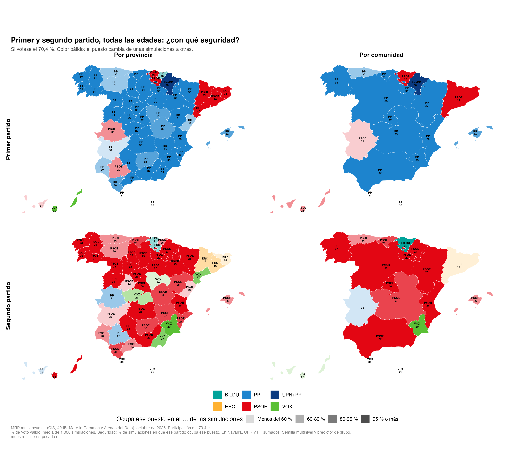
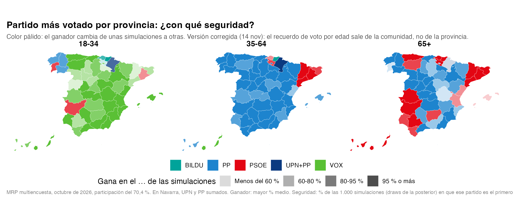

```{r setup}
#| include: false
source(here::here("2026/11/mrp-multiencuesta/iv-funciones.R"))
```

# Advertencia

Todo lo que viene a continuación es el resultado de haber unido en posts anteriores unas 9 encuestas con microdatos, varias del CIS, 40dB, Ateneo del Dato y More in Common.  Para una estimación usando datos de más encuestas (agregadas), y añadir errores históricos de las encuestas, y correlación de errores entre partidos tengo los otros posts. 

- [Pronóstico que se actualiza de vez en cuando](https://muestrear-no-es-pecado.es/2026/10/full-bayesian/seguimiento)
- [Metodología del meta análisis bayesiano](https://muestrear-no-es-pecado.es/2026/10/full-bayesian/full-bayesian)

La serie del MRP con varias encuestas:

1. [MRP con varias encuestas (I): nueve encuestas y una tabla de postestratificación](index.qmd)
2. [MRP con varias encuestas (II): el modelo, de las provincias a los escaños](ii-modelo.qmd)
3. [MRP con varias encuestas (III): voto más simpatía, participación](iii-participacion.qmd)
4. MRP con varias encuestas (IV): este post

# Actualización (16 de noviembre)

::: callout-important
## Qué ha cambiado

Después de publicar este post he revisado el modelo a raíz de los comentarios. Tres cambios:

- **La tabla de postestratificación.** La relación entre edad y recuerdo de voto dentro de cada comunidad ya no se copia de los pocos encuestados de cada grupo: sale de un modelo multinivel que combina el patrón de toda España con lo propio de cada comunidad. Tiene menos ruido y predice mejor el recuerdo de voto de encuestas que no ha visto (incluido el postelectoral del CIS de 2023).
- **El modelo de voto.** Usa el resultado del 23-J en cada provincia como predictor de grupo. Sobre todo para los de 18 a 20 años, que no tienen recuerdo de voto y heredaban la tendencia nacional: en el País Vasco el voto a VOX de ese grupo baja del 18 % al 13 %.
- **Navarra.** El 29-N UPN y PP se presentan juntos, y así se suman en los mapas y en el reparto de escaños.

En el total nacional casi nada cambia (menos de 0,1 puntos en el voto). Todo el post está recalculado con el modelo nuevo. Donde más cambia es en Cataluña de 25 a 34 años (ahora PSOE 20,1 % y VOX 19,3 %, un empate), Cataluña de 18 a 20 (ERC primero) y Navarra de 18 a 34 (PSOE 17,8 %, VOX 16,3 %); lo comento en cada caso.

**La participación (17 de noviembre).** Los mapas y las tablas del final usan la participación del 23-J (70,4 %). Antes usaba el 80 %, pero desde 1982 no ha votado tanta gente. Además, subir al 80 % quita casi un punto al PP (27,9 % → 27,0 %), mientras VOX se queda igual (19,7 % → 19,6 %). Con eso VOX gana un escaño y medio a costa del PP. La segunda parte (las preguntas a la posterior) también usa el 70,4 %. Las tablas de los comentarios siguen al 80 %: con el 70,4 % no cambia el partido más votado en ningún caso, y las diferencias no pasan de 1,7 puntos.
:::

Estos son los dos mapas que tienen más sentido: el primer y el segundo partido en cada provincia y en cada comunidad, sin separar por edad, con la misma participación que el 23-J (el 70,4 %). Son los que se podrán contrastar con el resultado del 29-N. El color pálido indica que ese puesto cambia de unas simulaciones a otras.

Ojo, que esto **no es un pronóstico**. Junta encuestas de junio a octubre, de cuando muchas cosas eran distintas, y la incertidumbre que muestran los colores es solo la del modelo y la de las muestras: no lleva el error histórico de las encuestas, que suele ser bastante mayor. Para un pronóstico, con ese error y con más encuestas, está el [seguimiento](https://muestrear-no-es-pecado.es/2026/10/full-bayesian/seguimiento).



::: callout-warning
## Los resultados por edad: con mucha cautela

Las estimaciones por edad dentro de una provincia o comunidad tienen mucha más incertidumbre de la que muestran los intervalos, y no se podrán comprobar con el resultado del 29-N (no hay datos oficiales por edad). Donde más dudas hemos visto:

- **Los de 18 a 20 años**, que no tienen recuerdo de voto y son pocos en cada comunidad (29 en el País Vasco, 44 en Galicia).
- **Los jóvenes de Navarra y el País Vasco**, sobre todo los que se abstuvieron o votaron a VOX en 2023: hay de 5 a 25 entrevistas por grupo y el modelo tira del patrón de toda España.
- **Los mayores de Galicia**: la tabla nueva suaviza un patrón real (los mayores gallegos votan más al PP que en el resto), así que lo de Pontevedra con más de 65 años no hay que creérselo.
- **Santa Cruz de Tenerife**, donde VOX no se presentó en 2023 y el modelo no tiene un recuerdo de VOX en el que apoyarse.
- **Las Palmas y Canarias**: el modelo pone a VOX primero en Las Palmas (30 %), lejos de su 14,5 % del 23-J. No es solo cosa del modelo: reponderando las entrevistas solo por recuerdo de voto, VOX también sale primero (27 %). Canarias tiene los efectos de comunidad y provincia más altos de VOX de toda España, sobre todo por el 40dB (40 % en Las Palmas), y los que se abstuvieron en 2023, que allí son muchos, votan a VOX más que en ningún otro sitio (42 % frente al 29 % de España). Puede ser real o un sesgo de las encuestas en Canarias; con estos datos no lo puedo separar.
- **Cataluña de 25 a 34**: las encuestas dan cosas muy distintas (un 15 % de VOX en el CIS y entre el 26 % y el 31 % en las demás), y el resultado depende de suponer que los jóvenes que se abstuvieron en 2023 votarán como dicen.
:::

Este post  tiene dos partes, que se pueden leer de forma independiente, creo yo.  Una que ha surgido hoy a raíz de un post en X que puse y que ha tenido cierta repercusión. Al leer algunos comentarios me planteé cambiar alguna cosa y comprobar otras. Esa es  la [primera parte](#primera-parte). 


La [segunda parte](#segunda-parte) va  de obtener "insights", (mátame Sergio, jajaj), que no se pueden obtener mediante la agregación de encuestas que no publican los microdatos. Aquí, tras intentar corregir por sexo, edad, recuerdo de voto, provincia etc, podemos hacer preguntas usando la posterior del modelo. Cosas como, ¿qué nos dicen estas 9 encuestas agregadas sobre  a quién y dónde votan los jóvenes? y cosas así. 

No tiene por qué parecerse a lo que va a pasar. Las encuestas fallan, y aunque son uno de los mejores instrumentos que tenemos para medir, no son perfectas. 

Sirva este análisis como un ejercicio estadístico y no sé si sociológico que pueda ser de ayuda a otra gente. 

::: callout-note
## Listening

<iframe data-testid="embed-iframe" style="border-radius:12px" src="https://open.spotify.com/embed/track/3nlGByvetDcS1uomAoiBmy?utm_source=generator&si=d02e7bc40b01454c" width="100%" height="352" frameBorder="0" allowfullscreen="" allow="autoplay; clipboard-write; encrypted-media; fullscreen; picture-in-picture" loading="lazy"></iframe>
:::

# Primera parte: lo que salió del tuit {#primera-parte}

## Un mapa en X

Este post iba a ser otra cosa. Iba a enseñar cómo, con la posterior del MRP
por celda, se contestan preguntas que una encuesta sola no puede contestar.
Pero antes publiqué en X este mapa: el partido más votado en cada provincia,
para tres tramos de edad.

```{=html}
<blockquote class="twitter-tweet" data-lang="es" data-dnt="true">
<a href="https://twitter.com/joscani/status/2121345003318333603">El mapa en X</a>
</blockquote>
<script async src="https://platform.twitter.com/widgets.js" charset="utf-8"></script>
```

Pasó de las 100.000 visualizaciones, y con ellas llegaron los comentarios. Desde
Ourense, que el PSOE primero entre los jóvenes no tenía sentido. Desde
Badajoz, lo mismo. Desde Navarra, que entre los jóvenes antes Bildu que VOX, y
que de Pamplona para arriba VOX no lo vota nadie. Desde Cataluña, que VOX
primera fuerza entre los jóvenes era una barbaridad. Y desde Galicia, que el
BNG gana entre los menores de 45.

Siguiendo con lo que predica el libro de Bayesian Workflow, uno debe revisar estas cosas, preguntarse por los límites del modelo y si hay alguna forma mejor de hacerlo. En eso 
consiste el oficio, probar, testar, corregir, y vuelta a empezar. 

Uno de esos comentarios hizo que pensara si en la tabla de postestratificación la
distribución conjunta en cada provincia entre recuerdo de voto y tramos de edad dependía demasiado de los datos de las encuestas en vez de lo poblacional. Y sí, así era, así que para suavizar ese efecto, se usa la relación que hay a nivel de comunidad autónoma. Tranquilos, los totales marginales de recuerdo de voto por provincia, de edad, sexo y nivel de estudios, salen respectivamente de los resultados del 23J y de otras tablas a nivel poblacional.  El raking nos da aproximaciones a la distribución conjunta, respetando las marginales, la parte en la que no llega lo toma de las encuestas. El comentario hizo que reflexionara sobre este tema. 


Los demás los he comprobado con los datos que tenemos. Todos de la misma forma:

1. Qué dicen las encuestas sin modelo: en bruto y ponderadas, sin y con
   recuerdo de voto.
2. Qué dice el MRP, con su incertidumbre: la media, el intervalo de
   credibilidad del 90 % y en qué proporción de los draws gana cada partido.
3. Si hay algo fuera de las encuestas con lo que contrastar, como los
   resultados del 23-J , también.

Unas veces el comentario tenía razón y el error era nuestro. Otras, el mapa
daba por seguro un ganador que era un empate. Otras, lo que parecía raro está
en los datos. Y otras, el modelo, sencillamente, no lo puede ver.

## A. El error con Ourense

Nos comentaban que no tenía sentido que el PSOE saliera primero entre los jóvenes en Ourense, y la causa era que la relación edad x recuerdo de voto salía de 16 jóvenes entrevistados por el CIS donde 8 recordaban haber votado al PSOE y 1 al PP.  Como comentaba antes, el procedimiento de raking fija los totales de cada provincia por edad (y sexo y estudios) y por recuerdo de voto, pero fijadas esas marginales, el recuerdo de a quién se ha votado en cada tramo de edad sale de la encuesta. Al usar el nivel de provincia esa distribución conjunta puede ser engañosa. 

Rehaciendo la tabla saldría lo siguiente. La segunda tabla compara, con el mismo modelo de voto, tres formas de construir la tabla de postestratificación: con la relación edad × recuerdo de cada provincia (la del mapa del tuit), con la de cada comunidad (la del 14 de noviembre) y con la semilla multinivel de la actualización. Con las dos últimas el PP vuelve a salir primero entre los jóvenes de Ourense. De hecho justo este perfil, en el que hay 17 
entrevistas en la unión de encuestas, sirve para ejemplificar por qué ponderar no es suficiente y son importantes cosas como los modelos multinivel para dar resultados plausibles. 


```{r ourense}
tabla_comentario("ourense", c("PP", "PSOE", "BNG", "VOX"))
ourense <- semilla_grupo("Ourense 18-34", c("PP", "PSOE"))
ourense
```


## B. El mapa exageraba la certeza

### Badajoz: ¿el PSOE gana entre los jóvenes?

En el mapa original, al poner solo el color de quien ganaba en cada provincia, se exageraba la seguridad del ganador. Por ejemplo en Badajoz entre los jóvenes de 18 a 34 años, el modelo daba casi un triple empate y el PSOE era primero en el 60 % de las simulaciones. Con el modelo actualizado el PSOE sale primero con más claridad (en el 88 % de las simulaciones), con PP y VOX empatados detrás. 

```{r badajoz}
tabla_comentario("badajoz")
```


### Navarra: ¿VOX antes que Bildu entre los jóvenes?

Otro comentario iba sobre que no se veía que Vox fuera por delante de Bildu entre los jóvenes en Navarra.  Y puff, a mí también me cuesta creerlo. Con el modelo actualizado, UPN y PP, que el 29-N van juntos, suman un 22,8 % y serían la primera opción en ese tramo de edad. Por separado, el PSOE queda primero (17,8 %) y Vox y Bildu, empatados detrás (16,3 % y 16,2 %).  

Es posible que aquí el MRP se columpie un poco, pero viendo el dato bruto y los ponderados están bastante empatados Vox y Bildu. Sigue costándome pensar que eso es así. Habrá que ver si se puede ver algo si sale un postelectoral.

```{r navarra}
tabla_comentario("navarra", c("VOX", "BILDU", "PSOE", "UPN", "PP"))
```
## Un mapa que dice cuán seguro es el ganador

Bueno, el mapa con el modelo actualizado (la tabla de postestratificación nueva y el predictor de grupo) e intentando reflejar la incertidumbre quedaría así, con la participación del 23-J (70,4 %). 



El código de este mapa está en [`28_mapa_seguridad_ganador.R`](https://github.com/joscani/blog_quarto/blob/master/2026/11/mrp-multiencuesta/completo/28_mapa_seguridad_ganador.R). El del mapa del tuit está en la sección 3.7 de [`20_preguntas.R`](https://github.com/joscani/blog_quarto/blob/master/2026/11/mrp-multiencuesta/completo/20_preguntas.R), que entonces usaba la tabla anterior.

## C. Lo que dicen los datos, sin modelo

### Cataluña: ¿VOX primera fuerza entre los jóvenes?

Entre jóvenes de 25 a 34 en Cataluña con 507 entrevistas hay datos suficientes, 
y tanto el dato bruto, como ponderando dicen que vox sería primera fuerza en ese tramo. Cuesta creerlo, lo sé. Pero a la vista del dato bruto y el ponderado parece eso. Sin embargo, el MRP baja esa estimación respecto a las ponderadas y, con el modelo actualizado, queda en un empate entre el PSOE (20,1 %) y Vox (19,3 %), con ERC detrás. Ojo: aquí las encuestas dicen cosas muy distintas (un 15 % de Vox en el CIS y entre el 26 % y el 31 % en las demás), y parte de ese voto a Vox viene de jóvenes que se abstuvieron en 2023 y dicen que ahora le votarían. 


```{r cataluna}
tabla_comentario("cataluna_25_34", c("VOX", "PSOE", "ERC", "JUNTS", "PP"))
```


### Galicia: ¿gana el BNG entre los menores de 45?

También comentaron que en Galicia el BNG sería primera fuerza entre menores de 45. Y tiene sentido teniendo en cuenta sus resultados en las últimas autonómicas. Pero en los datos que tenemos no se ve eso. 

En bruto primera fuerza sería el psoe, ponderando (con y sin recuerdo de voto) también sería el psoe, y en el MRP sería el PP (26,0 % frente al 22,0 % del PSOE).

```{r galicia}
tabla_comentario("galicia_menos_45", c("PSOE", "PP", "BNG", "VOX"))
```

## D. Lo que el modelo no puede ver

### Debajo de la provincia: el norte de Navarra

Otro comentario decía que en Navarra no vota Vox ni perri, sobre todo en la zona norte. 
En el 2023 los resultados en Navarra fueron estos. 

```{r navarra-23j}
tabla_navarra_zonas()
```

```{r navarra-23j-municipios}
tabla_navarra_municipios()
```

Las encuestas para 2026 ofrecen como mucho dato a nivel provincial, así que hasta ahí llega su granularidad. No podemos dar cosa más fina. 

Según estas encuestas, y [son varias agregadas](https://muestrear-no-es-pecado.es/2026/11/mrp-multiencuesta/)  el % de votos a Vox está en torno al 10%, un 12 % según el modelo. 

```{r navarra-total}
tabla_comentario("navarra_total", c("PSOE", "PP", "BILDU", "VOX"))
```


### Los de 18 a 20: la curva de edad es nacional

La gente que hoy tiene entre 18 y 20 años son nuevos votantes, y no tienen "recuerdo de voto".  En este grupo de edad es donde más se separa el MRP del bruto, cosas como que en el País Vasco en bruto el voto a vox sea del 3,4 % y que en el MRP de la primera versión llegase al 18 % hace sospechar que aquí el partial pooling se ha columpiado. El modelo multinivel detecta una subida grande del voto a Vox entre los más jóvenes y el partial pooling le presta esa subida a los jóvenes del País Vasco.  Y con tan solo 29 entrevistas en ese grupo de edad en el País Vasco, el partial pooling tira más hacia la info general.  No free lunch, como se decía en época pre IA. 

El problema de fondo es que, al no tener recuerdo de voto, a los de 18 a 20 no les llega la información política de su provincia. El modelo actualizado usa como predictor de grupo el resultado del 23-J en cada provincia, y con eso el voto a Vox de los de 18 a 20 en el País Vasco baja al 12,6 %. Sigue por encima del dato bruto: el predictor corrige lo que explica el voto de cada provincia en toda España, y con 29 entrevistas el modelo no se fía del todo de lo que se sale de ahí. 


```{r cataluna-18-20}
tabla_comentario("cataluna_18_20", c("VOX", "PSOE", "ERC"))
tabla_comentario("pais_vasco_18_20", c("PSOE", "VOX", "BILDU", "PNV"))
tabla_vox_18_20()
```


---

# Segunda parte: preguntas a la posterior {#segunda-parte}

Con la tabla ya corregida, y sabiendo dónde se columpia el modelo, vamos con lo que iba a ser el post, que al final parece que va a ser largo. 
El MRP no da solo una estimación por provincia, da, para cada celda de la tabla de postestratificación, 1.000 (porque voy a sacar 1000, pero podría usar 4000, no cambia nada)
versiones plausibles de cuánta gente vota y a quién. 

Con eso se contesta
casi cualquier pregunta sobre grupos de población que tenemos como variables en el modelo y en la tabla de postestratificación, a saber, provincia, sexo, edad, nivel de estudios y recuerdo de voto, y siempre con las mismas
cuatro operaciones:

1. **De probabilidades a personas:** votos = N × participación × p.
2. **Agregar:** sumar los votos de las celdas del grupo, en cada draw.
3. **Resumir:** media e intervalo de los 1.000 draws.
4. **Contar:** la probabilidad de algo es la proporción de draws en que ocurre.

Todas las cifras son para octubre de 2026, con la participación del 23-J (70,4 %), la misma que en los mapas del principio.

```{r p2-setup}
#| code-fold: false
library(tidyverse)
library(sf)

dir_completo <- here::here("2026/11/mrp-multiencuesta/completo/datos")

colores <- c(
  PP = "#1D84CE",
  PSOE = "#E30613",
  VOX = "#5AC035",
  SUMAR = "#E5007D",
  PODEMOS = "#6B2E68",
  ERC = "#FFB232",
  JUNTS = "#00C3B2",
  BILDU = "#00A39A",
  PNV = "#008135",
  BNG = "#ADCFEF",
  CCA = "#FFD700",
  AA = "#2E8B57",
  UPN = "#0A3A80",
  OTROS = "grey60",
  BLANCO = "grey90"
)
```

## Las dos tablas

La tabla de postestratificación: quiénes son y cuántos. Una fila por celda
(provincia × sexo × edad × estudios × recuerdo del 23-J).

Tenemos 12300 celdas y en cada una una columna N que indica cuánta población hay ahí. Su suma es la población de 18 años y más (Censo anual de Población del INE)
```{r p2-tablas}
#| code-fold: false
celdas <- readRDS(file.path(dir_completo, paste0("tabla_post", sufijo_modelo, ".rds")))
celdas

sum(celdas$N) # población de 18 y más
```

La posterior: lo que el modelo dice de cada celda. Una fila por draw y celda:
`part` es la probabilidad de votar y las columnas de partido, el reparto del
voto entre los que votan (suman 1).

En posterior tenemos 12 millones 300 mil filas: 12300 celdas x 1000 draws en cada una.

```{r p2-posterior}
#| code-fold: false
posterior <- readRDS(file.path(dir_completo, paste0("posterior_celdas_70", sufijo_modelo, ".rds"))) # participación del 70,4 %
posterior

partidos <- setdiff(names(posterior), c("draw", "celda", "part"))
partidos
```

## Una celda

Hombres de 25 a 34 años, con estudios medios, de Madrid, que no votaron en 2023.

```{r p2-celda}
#| code-fold: false
ejemplo <- celdas |>
  filter(
    provincia == "Madrid",
    sexo == "Hombres",
    edad == "25-34",
    edu == "media",
    rec == "ABST"
  )
ejemplo

# su posterior: 1.000 filas, una por draw
post_ejemplo <- posterior |>
  filter(celda == ejemplo$celda) |>
  select(draw, part, PP, PSOE, VOX, SUMAR)
post_ejemplo

# cada fila es una versión plausible de la celda; resumirlas es la incertidumbre
post_ejemplo |>
  summarise(across(
    -draw,
    list(media = mean, q05 = \(x) quantile(x, 0.05), q95 = \(x) {
      quantile(x, 0.95)
    })
  ))
```

¿Cuántos de ellos votarían? La columna `part` es la probabilidad de votar de
la celda, con la participación de toda España calibrada al 70,4 % en cada draw.

```{r p2-celda-participacion}
#| code-fold: false
part_ejemplo <- post_ejemplo |>
  summarise(
    media = 100 * mean(part),
    q05 = 100 * quantile(part, 0.05),
    q95 = 100 * quantile(part, 0.95)
  )
part_ejemplo
```

Si en España votase el 70,4 %, en esta celda votaría el
`r format(round(part_ejemplo$media, 1), decimal.mark = ",")` %
(intervalo del 90 %: `r format(round(part_ejemplo$q05, 1), decimal.mark = ",")`-`r format(round(part_ejemplo$q95, 1), decimal.mark = ",")` %):
unos `r format(round(ejemplo$N * part_ejemplo$media / 100, -2), big.mark = ".")`
de sus `r format(round(ejemplo$N, -2), big.mark = ".")` hombres.

Para este perfil/ celda con solo 9 entrevistas en los datos (3 del CIS, 2 de 40dB y 4 de More in Common) podemos dar estimaciones de cómo votarán 

```{r p2-celda-grafico}
post_ejemplo_largo <- post_ejemplo |>
  pivot_longer(c(PP, PSOE, VOX, SUMAR), names_to = "partido", values_to = "p")

etiquetas <- post_ejemplo_largo |>
  summarise(p = mean(p), .by = partido)

ggplot(post_ejemplo_largo, aes(p, fill = partido)) +
  geom_histogram(
    binwidth = 0.005,
    boundary = 0,
    position = "identity",
    alpha = 0.7
  ) +
  geom_text(
    data = etiquetas,
    aes(p, y = 0, label = partido, colour = partido),
    vjust = -0.5,
    nudge_y = 230,
    fontface = "bold"
  ) +
  scale_fill_manual(
    values = colores,
    aesthetics = c("fill", "colour"),
    guide = "none"
  ) +
  scale_x_continuous(labels = scales::percent) +
  labs(
    x = "Proporción de voto",
    y = "draws",
    title = "La posterior de una celda: 1.000 valores plausibles por partido",
    subtitle = paste0(
      "Hombres, 25-34, estudios medios, Madrid, abstención en 2023 (N = ",
      format(round(ejemplo$N), big.mark = "."),
      ")"
    )
  ) +
  theme_minimal() +
  theme(
    panel.grid.minor = element_blank(),
    plot.title = element_text(face = "bold")
  )
```

## De probabilidades a personas

Para este ejemplo, para cada draw, tenemos valores distintos de participación y de proporción de voto a cada partido. El proceso es simple, en cada draw calculamos cuántos votan según la estimación de participación, y multiplicamos por la proporción de voto de cada partido. Para Vox y Frente Amplio se tendría

```{r p2-personas}
#| code-fold: false
post_ejemplo |>
  rename(FA = SUMAR) |>
  mutate(
    N = ejemplo$N,
    votantes = N * part,
    votos_vox = votantes * VOX,
    votos_frente_amplio = votantes * FA
  ) |>
  select(draw, N, part, votantes, VOX, votos_vox, FA, votos_frente_amplio)
```

## Agregar, resumir y contar

Un grupo son muchas celdas. Los hombres de 25 a 34 años de toda España: se
eligen sus celdas y se suma en cada draw.

```{r p2-agregar}
#| code-fold: false
celdas_grupo <- celdas |> filter(sexo == "Hombres", edad == "25-34")
nrow(celdas_grupo) # celdas que forman el grupo

# en cada draw: sumar votantes y votos de todas las celdas del grupo
grupo <- posterior |>
  rename(FA = SUMAR) |>
  inner_join(select(celdas_grupo, celda, N), by = "celda") |>
  summarise(
    votantes = sum(N * part),
    votos_vox = sum(N * part * VOX),
    votos_frente_amplio = sum(N * part * FA),
    .by = draw
  ) |>
  mutate(
    pct_vox = 100 * votos_vox / votantes,
    pct_frente_amplio = 100 * votos_frente_amplio / votantes
  )
grupo # una fila por draw: 1.000 valores plausibles de cada %

# resumir
grupo |>
  summarise(
    across(
      c(pct_vox, pct_frente_amplio),
      list(media = mean, q05 = \(x) quantile(x, 0.05), q95 = \(x) {
        quantile(x, 0.95)
      })
    )
  )
```

Y con esto podemos calcular probabilidades, como por ejemplo ¿cuál es la probabilidad de que en este grupo vox saque más de un 30% del voto ? 

```{r p2-contar}
#| code-fold: false
# contar: ¿qué probabilidad hay de que más del 30 % de ese grupo vote a VOX?
mean(grupo$pct_vox > 30)
```

Eso sí, estas probabilidades son las del modelo: dan por buenos sus supuestos. Si el modelo se columpia, como con los de 18 a 20 de la primera parte, los intervalos no lo avisan.

## Las cuatro operaciones, en funciones

Para no repetir el código en cada pregunta.

```{r p2-funciones}
#| code-fold: false
# votos de cada partido por draw y grupo
#   por:        variables que definen el grupo (character(0) = toda la población)
#   celdas_sel: las celdas que entran (filtra antes para una comunidad, etc.)
votos_por <- function(por, celdas_sel = celdas) {
  posterior |>
    inner_join(select(celdas_sel, celda, N, all_of(por)), by = "celda") |>
    summarise(
      across(all_of(partidos), ~ sum(N * part * .x)),
      .by = all_of(c("draw", por))
    ) |>
    pivot_longer(all_of(partidos), names_to = "partido", values_to = "votos") |>
    mutate(pct = 100 * votos / sum(votos), .by = all_of(c("draw", por)))
}

# media e intervalo de credibilidad del 90 % de una columna sobre los draws
resume <- function(datos, por, x = "pct") {
  datos |>
    summarise(
      media = mean(.data[[x]]),
      q05 = quantile(.data[[x]], 0.05),
      q95 = quantile(.data[[x]], 0.95),
      .by = all_of(por)
    ) |>
    arrange(across(all_of(por)))
}

# % que vota en cada grupo y draw
participacion_por <- function(por, celdas_sel = celdas) {
  posterior |>
    select(draw, celda, part) |>
    inner_join(select(celdas_sel, celda, N, all_of(por)), by = "celda") |>
    summarise(part = 100 * sum(N * part) / sum(N), .by = all_of(c("draw", por)))
}

# tabla ancha para leer
ancho <- function(datos, filas, columnas, valor = "media", digitos = 1) {
  datos |>
    select(all_of(c(filas, columnas, valor))) |>
    mutate(across(all_of(valor), \(x) round(x, digitos))) |>
    pivot_wider(names_from = all_of(columnas), values_from = all_of(valor))
}

# comprobación: la función da lo mismo que el cálculo a mano
votos_por(c("sexo", "edad")) |>
  filter(sexo == "Hombres", edad == "25-34", partido == "SUMAR") |>
  resume("partido")
```

```{r p2-graficos}
# aspecto de los gráficos y gráfico de efectos
principales <- c("PP", "PSOE", "VOX", "SUMAR", "PODEMOS")

tema <- theme_minimal(base_size = 12) +
  theme(
    panel.grid.minor = element_blank(),
    panel.grid.major.x = element_blank(),
    plot.title = element_text(face = "bold"),
    plot.title.position = "plot",
    plot.caption = element_text(colour = "grey50", hjust = 0),
    legend.position = "top",
    strip.text = element_text(face = "bold", size = 12)
  )
fuente <- "MRP multiencuesta, octubre de 2026, participación del 70,4 %. Media e intervalo de credibilidad del 90 %."
fuente_media <- "MRP multiencuesta, octubre de 2026, participación del 70,4 %. Media de los 1.000 draws."

# % de voto de cada grupo real (postestratificado), no "con lo demás constante":
# si los jóvenes tienen más estudios, eso entra en la curva de la edad
efecto <- function(
  x,
  partidos_sel,
  color = NULL,
  celdas_sel = celdas,
  ylim = NULL,
  escalas = "free_y"
) {
  d <- votos_por(c(x, color), celdas_sel) |>
    resume(c(x, color, "partido")) |>
    filter(partido %in% partidos_sel) |>
    mutate(partido = factor(partido, partidos_sel))
  if (is.null(ylim)) {
    ylim <- c(0, max(d$q95))
  }
  if (is.null(color)) {
    final <- d |> filter(.data[[x]] == last(levels(.data[[x]])))
    return(
      ggplot(
        d,
        aes(
          .data[[x]],
          media,
          ymin = q05,
          ymax = q95,
          colour = partido,
          fill = partido,
          group = partido
        )
      ) +
        geom_ribbon(alpha = 0.2, colour = NA) +
        geom_line(linewidth = 1) +
        geom_point(size = 2) +
        ggrepel::geom_text_repel(
          data = final,
          aes(label = partido),
          hjust = 0,
          nudge_x = 0.15,
          direction = "y",
          fontface = "bold",
          size = 4,
          segment.colour = NA,
          box.padding = 0.1
        ) +
        scale_colour_manual(
          values = colores,
          aesthetics = c("colour", "fill"),
          guide = "none"
        ) +
        scale_y_continuous(breaks = seq(0, 100, by = 5)) +
        coord_cartesian(ylim = ylim, clip = "off") +
        labs(x = NULL, y = "% de voto", caption = fuente) +
        tema +
        theme(plot.margin = margin(5.5, 60, 5.5, 5.5))
    )
  }
  ggplot(
    d,
    aes(
      .data[[x]],
      media,
      ymin = q05,
      ymax = q95,
      colour = .data[[color]],
      fill = .data[[color]],
      group = .data[[color]]
    )
  ) +
    geom_ribbon(alpha = 0.2, colour = NA) +
    geom_line(linewidth = 1) +
    geom_point(size = 2) +
    scale_colour_manual(
      values = c("#D95F02", "#1B9E77", "#7570B3"),
      aesthetics = c("colour", "fill")
    ) +
    facet_wrap(~partido, scales = escalas) +
    (if (escalas == "fixed") coord_cartesian(ylim = ylim)) +
    scale_x_discrete(guide = guide_axis(n.dodge = 2)) +
    labs(
      x = NULL,
      y = "% de voto",
      colour = NULL,
      fill = NULL,
      caption = fuente
    ) +
    tema
}

provincias_sf <- readRDS(file.path(dir_completo, "provincias_sf.rds"))
mapa <- function(datos) {
  provincias_sf |>
    left_join(datos, by = c("codigo_provincia" = "cod")) |>
    ggplot() +
    theme_void(base_size = 12) +
    theme(
      plot.title = element_text(face = "bold"),
      plot.caption = element_text(colour = "grey50", hjust = 0),
      strip.text = element_text(face = "bold", size = 12),
      plot.margin = margin(10, 10, 10, 10)
    )
}

bloque_de <- function(partido) {
  case_when(
    partido %in% c("PP", "VOX", "UPN", "SALF") ~ "Derecha",
    partido %in%
      c("PSOE", "SUMAR", "PODEMOS", "ERC", "BILDU", "BNG", "AA") ~ "Izquierda",
    partido == "BLANCO" ~ "Blanco",
    .default = "Otros"
  )
}
celdas <- celdas |>
  mutate(
    tramo = case_when(
      edad %in% c("18-20", "21-24", "25-34") ~ "18-34",
      edad == "65+" ~ "65+",
      .default = "35-64"
    )
  )
```

## ¿Vota distinto cada edad?

Vamos con algunas preguntas. El voto por edad. 

```{r p2-edad}
#| code-fold: false
voto_edad <- votos_por("edad")

voto_edad |>
  resume(c("edad", "partido")) |>
  filter(partido %in% principales) |>
  ancho("edad", "partido")

# partido más votado en cada edad, y en qué % de draws lo es
voto_edad |>
  mutate(primero = pct == max(pct), .by = c(draw, edad)) |>
  summarise(
    p_primero = mean(primero),
    pct = mean(pct),
    .by = c(edad, partido)
  ) |>
  filter(p_primero > 0.05) |>
  arrange(edad, desc(p_primero))
```

Pues con los datos que usamos, Vox está fuerte entre los jóvenes, y PP y PSOE se parecen bastante en su perfil de voto por edad.

```{r p2-edad-grafico}
efecto("edad", c("PP", "PSOE", "VOX", "SUMAR"), ylim = c(0, 35)) +
  labs(title = "Voto por edad")
```

¿El bipartidismo es cosa de mayores? % de PP + PSOE por edad, sumado en cada draw.


```{r p2-bipartidismo}
#| code-fold: false
voto_edad |>
  filter(partido %in% c("PP", "PSOE")) |>
  summarise(pct = sum(pct), .by = c(draw, edad)) |>
  resume("edad")
```

## Sexo: la brecha y quién vota a cada partido

Brecha por partido: % entre los hombres menos % entre las mujeres, en cada draw.


```{r p2-brecha}
#| code-fold: false
votos_por("sexo") |>
  select(draw, sexo, partido, pct) |>
  pivot_wider(names_from = sexo, values_from = pct) |>
  mutate(brecha = Hombres - Mujeres) |>
  resume("partido", "brecha") |>
  arrange(desc(media))
```

Con los mismos votos se pueden hacer dos preguntas distintas. Primero, los
votos (en miles, media de los draws) por sexo y edad, para VOX y el PSOE, y
el total de votos de cada grupo:

```{r p2-filas-columnas}
#| code-fold: false
votos_grupo <- votos_por(c("sexo", "tramo")) |>
  summarise(votos = mean(votos), .by = c(sexo, tramo, partido)) |>
  pivot_wider(names_from = partido, values_from = votos) |>
  mutate(total = rowSums(across(all_of(partidos)))) |>
  select(sexo, tramo, VOX, PSOE, total)

votos_grupo |> mutate(across(c(VOX, PSOE, total), \(x) round(x / 1000)))
```

**¿Cómo votan los hombres de 18 a 34 años?** Se divide cada fila por su
total: de cada 100 votos del grupo, cuántos van a cada partido.

```{r p2-filas}
#| code-fold: false
votos_grupo |>
  mutate(
    VOX = round(100 * VOX / total, 1),
    PSOE = round(100 * PSOE / total, 1)
  ) |>
  select(sexo, tramo, VOX, PSOE)
```

**¿Quién vota a VOX?** Se divide cada columna por su total: de cada 100
votos de VOX, cuántos vienen de cada grupo. La última columna es el peso de
cada grupo entre todos los votantes, para comparar.

```{r p2-columnas}
#| code-fold: false
votos_grupo |>
  mutate(
    VOX = round(100 * VOX / sum(VOX), 1),
    PSOE = round(100 * PSOE / sum(PSOE), 1),
    todos = round(100 * total / sum(total), 1)
  ) |>
  select(sexo, tramo, VOX, PSOE, todos)
```

Vemos en cada grupo de edad y sexo su % de voto a partidos

```{r p2-sexo-edad}
#| fig-height: 6
efecto(
     "edad",
     c("PP", "PSOE", "VOX", "SUMAR"),
     color = "sexo",
     ylim = c(0, 40),
     escalas = "fixed"
) +
     labs(title = "Voto por edad y sexo")
```

El modelo no tiene interacción sexo × edad: si la brecha de sexo cambia con
la edad, es por la composición de cada grupo (estudios, recuerdo, provincia),
no porque el modelo la haya estimado.

## Estudios

```{r p2-estudios}
#| fig-height: 6
efecto("edad", principales, color = "edu") +
  labs(title = "Voto por edad y estudios")
```

```{r p2-estudios-tabla}
#| code-fold: false
# ¿qué estudios tiene el votante de cada partido?
votos_por("edu") |>
  mutate(pct_partido = 100 * votos / sum(votos), .by = c(draw, partido)) |>
  resume(c("edu", "partido"), "pct_partido") |>
  filter(partido %in% principales) |>
  ancho("partido", "edu")
```

## Territorio: voto por edad en cinco comunidades

Las mismas cuentas, solo con las celdas de una comunidad. Cada gráfico tiene
su propio eje Y. Ojo con el primer punto (18-20): son nuevos votantes, sin
recuerdo de voto, y es donde el modelo más tira hacia la curva nacional (lo
vimos en la primera parte, con Cataluña y el País Vasco).

```{r p2-territorio-madrid}
efecto(
     "edad",
     c("PP", "PSOE", "VOX", "SUMAR", "PODEMOS"),
     celdas_sel = filter(celdas, ccaa == "Madrid")
) +
     labs(title = "Madrid: voto por edad")
```

En la primera versión de este post había un zigzag del PP en Madrid (más alto
entre los de 21 a 24 años que entre los de 25 a 34) que no era una cosa de la
edad, sino de la tabla de postestratificación. En aquella tabla, el 29,0 % de
los madrileños de 21 a 24 años votó al PP en 2023, frente al 17,8 % de los de
25 a 34; con la tabla nueva son el 21,1 % y el 19,6 %, y el zigzag casi
desaparece. Esa relación entre
edad y recuerdo sale de la semilla del raking, que solo usa entrevistas del
CIS: en Madrid, 34 de 103 jóvenes de 21 a 24 años recuerdan haber votado al
PP (33 %), frente a 60 de 289 de 25 a 34 (21 %). En las otras tres casas no
pasa: 15 de 90 (17 %) entre los de 21 a 24 y 55 de 288 (19 %) entre los de 25
a 34. Es lo mismo que en Ourense, con más entrevistas: el cruce edad ×
recuerdo dentro de cada provincia arrastraba el ruido de la muestra del CIS,
y es justo lo que corrige la semilla multinivel.

```{r p2-territorio-cataluna}
efecto(
     "edad",
     c("PSOE", "ERC", "JUNTS", "VOX", "PP"),
     celdas_sel = filter(celdas, ccaa == "Cataluña")
) +
     labs(title = "Cataluña: voto por edad")
```

```{r p2-territorio-pais-vasco}
efecto(
     "edad",
     c("BILDU", "PNV", "PSOE", "PP", "VOX"),
     celdas_sel = filter(celdas, ccaa == "País Vasco")
) +
     labs(title = "País Vasco: voto por edad")
```

```{r p2-territorio-andalucia}
efecto(
     "edad",
     c("PP", "PSOE", "VOX", "SUMAR", "AA"),
     celdas_sel = filter(celdas, ccaa == "Andalucía")
) +
     labs(title = "Andalucía: voto por edad")
```

```{r p2-territorio-galicia}
efecto(
     "edad",
     c("PP", "PSOE", "BNG", "VOX"),
     celdas_sel = filter(celdas, ccaa == "Galicia")
) +
     labs(title = "Galicia: voto por edad")
```

## Desde el 23-J: de dónde viene el voto

El recuerdo es una variable más de la celda: se agrega igual.

```{r p2-origen-datos}
#| code-fold: false
origen <- votos_por("rec") |>
  mutate(pct_partido = 100 * votos / sum(votos), .by = c(draw, partido)) |>
  resume(c("rec", "partido"), "pct_partido")
```

```{r p2-origen}
origen |>
  filter(partido %in% c("PP", "PSOE", "VOX", "SUMAR")) |>
  mutate(
    partido = factor(partido, c("SUMAR", "VOX", "PSOE", "PP")),
    origen = case_when(
      rec %in% c("PP", "PSOE", "VOX", "SUMAR") ~ as.character(rec),
      rec == "ABST" ~ "Abstención",
      rec == "NO_PODIA" ~ "No podía votar",
      .default = "Otros"
    ),
    origen = factor(
      origen,
      c("PP", "PSOE", "VOX", "SUMAR", "Otros", "Abstención", "No podía votar")
    )
  ) |>
  summarise(media = sum(media), .by = c(partido, origen)) |>
  ggplot(aes(media, partido, fill = origen)) +
  geom_col(width = 0.7, colour = "white", linewidth = 0.3) +
  scale_fill_manual(
    values = c(
      colores[c("PP", "PSOE", "VOX", "SUMAR")],
      Otros = "grey80",
      `Abstención` = "grey45",
      `No podía votar` = "grey20"
    )
  ) +
  scale_x_continuous(labels = \(x) paste0(x, " %")) +
  labs(
    x = "% de los votantes del partido",
    y = NULL,
    fill = "Votó en 2023",
    title = "¿De dónde viene el voto de cada partido?",
    caption = fuente_media
  ) +
  tema +
  theme(
    panel.grid.major.y = element_blank(),
    panel.grid.major.x = element_line()
  )
```

¿Repiten más los mayores? De cada 100 votantes de un partido en 2023, cuántos
lo vuelven a votar, por edad (los de 18-20 no podían votar). 

```{r p2-fidelidad-datos}
#| code-fold: false
fidelidad <- votos_por(
     c("rec", "edad"),
     filter(celdas, rec %in% c("PP", "PSOE", "VOX", "SUMAR"))
) |>
     filter(partido == as.character(rec)) |>
     mutate(partido = factor(partido, c("PP", "PSOE", "VOX", "SUMAR"))) |>
     resume(c("partido", "edad"))
```

```{r p2-fidelidad}
ggplot(
     fidelidad,
     aes(
          edad,
          media,
          ymin = q05,
          ymax = q95,
          colour = partido,
          fill = partido,
          group = partido
     )
) +
     geom_ribbon(alpha = 0.2, colour = NA) +
     geom_line(linewidth = 1) +
     geom_point(size = 2) +
     scale_colour_manual(values = colores, aesthetics = c("colour", "fill")) +
     coord_cartesian(ylim = c(0, 100)) +
     labs(
          x = NULL,
          y = "% que repite partido",
          colour = NULL,
          fill = NULL,
          title = "¿Repiten más los mayores?",
          subtitle = "De cada 100 votantes de cada partido en 2023, cuántos lo vuelven a votar",
          caption = fuente
     ) +
     tema
```

## ¿Quién vota?

La participación total es el 70,4 % por construcción; lo que cambia es quién.

```{r p2-participacion}
#| code-fold: false
participacion_por("edad") |> resume("edad", "part")
participacion_por(c("edu", "sexo")) |>
  resume(c("edu", "sexo"), "part") |>
  ancho("edu", "sexo", "media")
```

## Mapas

```{r p2-mapas-datos}
#| code-fold: false
voto_prov_tramo <- votos_por(c("cod", "tramo"))
```

¿El bipartidismo es cosa de mayores, también por provincia?

```{r p2-mapa-bipartidismo-datos}
#| code-fold: false
bipartidismo <- voto_prov_tramo |>
  filter(tramo != "35-64", partido %in% c("PP", "PSOE")) |>
  summarise(pct = sum(pct), .by = c(draw, cod, tramo)) |>
  resume(c("cod", "tramo"))
```

```{r p2-mapa-bipartidismo}
mapa(bipartidismo) +
  geom_sf(aes(fill = media), colour = "white", linewidth = 0.1) +
  facet_wrap(~tramo) +
  scale_fill_viridis_c(limits = c(0, 80)) +
  labs(
    fill = "%",
    title = "¿El bipartidismo es cosa de mayores?",
    subtitle = "% de voto a PP + PSOE",
    caption = fuente_media
  ) +
  theme(legend.position = "bottom")
```

¿Votan más a la derecha los jóvenes o los mayores? Diferencia en el % de PP +
VOX + UPN entre los menores de 35 y los de 65 y más.

```{r p2-mapa-brecha-datos}
#| code-fold: false
brecha_gen <- votos_por(c("cod", "tramo"), filter(celdas, tramo != "35-64")) |>
  mutate(bloque = bloque_de(partido)) |>
  summarise(pct = sum(pct), .by = c(draw, cod, tramo, bloque)) |>
  filter(bloque == "Derecha") |>
  select(draw, cod, tramo, pct) |>
  pivot_wider(names_from = tramo, values_from = pct) |>
  mutate(brecha = `18-34` - `65+`) |>
  resume("cod", "brecha") |>
  left_join(distinct(celdas, cod, provincia), by = "cod")
```

```{r p2-mapa-brecha}
brecha_gen <- brecha_gen |>
  mutate(
    etiqueta = if_else(
      media %in% range(media),
      paste0(provincia, "\n", sprintf("%+.0f", media)),
      NA
    )
  )

quien_mas <- function(x) {
  case_when(
    x < 0 ~ paste0("Mayores +", abs(x)),
    x > 0 ~ paste0("Jóvenes +", x),
    .default = "Igual"
  )
}

mapa(brecha_gen) +
  geom_sf(aes(fill = media), colour = "white", linewidth = 0.1) +
  geom_sf_text(
    aes(label = etiqueta),
    size = 3.2,
    fontface = "bold",
    lineheight = 0.9,
    na.rm = TRUE,
    fun.geometry = \(g) suppressWarnings(sf::st_point_on_surface(g))
  ) +
  scale_fill_gradient2(
    low = "#E66101",
    mid = "grey97",
    high = "#5E3C99",
    limits = c(-20, 20),
    breaks = c(-20, -10, 0, 10, 20),
    labels = quien_mas
  ) +
  guides(
    fill = guide_colourbar(
      barwidth = unit(12, "cm"),
      barheight = unit(0.4, "cm"),
      title.position = "top",
      title.hjust = 0.5
    )
  ) +
  labs(
    fill = "Puntos de diferencia en el % de voto a la derecha (PP + VOX + UPN)",
    title = "¿Votan más a la derecha los jóvenes o los mayores?",
    subtitle = "Menores de 35 frente a 65 y más, por provincia",
    caption = fuente_media
  ) +
  theme(legend.position = "bottom")
```

## ¿Y si solo votasen los jóvenes? ¿Y solo las mujeres?

D'Hondt por provincia con el umbral del 3 %, con los votos de un solo grupo,
en cada draw.

```{r p2-congresos}
#| code-fold: false
escanos <- celdas |> distinct(cod, escanos)

reparto <- function(votos) {
  votos |>
    # el 29-N, UPN y PP van juntos en Navarra (cod 31): una sola lista
    mutate(partido = if_else(cod == 31 & partido == "UPN", "PP", partido)) |>
    summarise(votos = sum(votos), pct = sum(pct), .by = c(draw, cod, partido)) |>
    filter(pct >= 3, !partido %in% c("OTROS", "BLANCO")) |>
    left_join(escanos, by = "cod") |>
    cross_join(tibble(divisor = 1:37)) |>
    filter(divisor <= escanos) |>
    mutate(
      orden = rank(-votos / divisor, ties.method = "first"),
      .by = c(draw, cod)
    ) |>
    filter(orden <= escanos) |>
    count(draw, partido, name = "escanos")
}

congresos <- bind_rows(
  Todos = reparto(votos_por("cod")),
  `18-34` = reparto(votos_por("cod", filter(celdas, tramo == "18-34"))),
  `65+` = reparto(votos_por("cod", filter(celdas, tramo == "65+"))),
  Mujeres = reparto(votos_por("cod", filter(celdas, sexo == "Mujeres"))),
  Hombres = reparto(votos_por("cod", filter(celdas, sexo == "Hombres"))),
  .id = "electorado"
) |>
  complete(electorado, draw, partido, fill = list(escanos = 0L))

# comprobación: 350 escaños en cada draw
stopifnot(all(
  summarise(congresos, total = sum(escanos), .by = c(electorado, draw))$total ==
    350
))

congresos |>
  resume(c("electorado", "partido"), "escanos") |>
  ancho("partido", "electorado", digitos = 0) |>
  arrange(desc(Todos))

# contar: probabilidad de mayoría absoluta de PP + VOX en cada electorado
mayorias <- congresos |>
  filter(partido %in% c("PP", "VOX")) |>
  summarise(escanos = sum(escanos), .by = c(electorado, draw)) |>
  summarise(
    media = mean(escanos),
    p_mayoria = mean(escanos >= 176),
    .by = electorado
  )
mayorias
```

```{r p2-congresos-texto}
#| include: false
# cifras del párrafo siguiente, sacadas de congresos y mayorias
esc_medio <- congresos |> summarise(escanos = mean(escanos), .by = c(electorado, partido))
primero_de <- function(e) esc_medio |> filter(electorado == e) |> slice_max(escanos, n = 1)
jov <- primero_de("18-34")
may <- primero_de("65+")
p_may <- \(e) round(100 * mayorias$p_mayoria[mayorias$electorado == e])
stopifnot(nrow(jov) == 1, nrow(may) == 1)
```

Si solo votasen los de 18 a 34, `r jov$partido` sería el partido con más escaños, unos `r round(jov$escanos)`. Si solo votasen los de 65 y más, ganaría el `r may$partido`, con unos `r round(may$escanos)`. PP + VOX suman mayoría absoluta en el `r p_may("18-34")` % de los draws si solo votasen los jóvenes, en el `r p_may("Hombres")` % si solo votasen los hombres y en el `r p_may("Todos")` % si votase todo el mundo; si solo votasen las mujeres, en el `r p_may("Mujeres")` %, y si solo votasen los mayores, en el `r p_may("65+")` %.

## El votante típico de cada partido

Los tres perfiles sexo × edad × estudios  que más votos dan a cada
partido, como % de los votantes del partido.

Uff. La siguiente tabla me desconcierta un poco. Los 3 perfiles típicos de cada partido.  
Y tiene que ver con el tamaño de cada perfil en la población, las mujeres de más de 65 años y nivel educativo bajo son el 10% de la población más o menos. Así que el votante típico de cada partido hay que compararlo con la población general. 

```{r p2-perfiles}
#| code-fold: false
votos_por(c("sexo", "edad", "edu")) |>
  filter(partido %in% c("PP", "PSOE", "VOX", "SUMAR")) |>
  mutate(pct_partido = 100 * votos / sum(votos), .by = c(draw, partido)) |>
  resume(c("partido", "sexo", "edad", "edu"), "pct_partido") |>
  slice_max(media, n = 3, by = partido) |>
  mutate(across(media:q95, \(x) round(x, 1)))
```

Una forma de verlo es haciendo un análisis de correspondencias, (sí, soy un viejuno)

El análisis de correspondencias [@greenacre2017] es la técnica de la escuela
francesa de análisis de datos, la de Benzécri, y la que usó Bourdieu en *La
distinción* [@bourdieu1979] para dibujar el espacio social y el de los gustos.
Aquí lo hacemos con FactoMineR [@le2008] y lo dibujamos con factoextra.

La tabla son los votos de cada partido (columnas) por perfil sexo × tramo de
edad × estudios (filas): 18 perfiles. Un perfil queda cerca de un partido cuando pesa más entre
sus votantes que entre todos los votantes. Los partidos regionales van
juntos y como columna suplementaria: su voto depende de la provincia, que no
está en las filas.

```{r p2-correspondencias-datos}
#| code-fold: false
library(FactoMineR)
library(factoextra)

regionales <- c("ERC", "JUNTS", "BILDU", "PNV", "BNG", "CCA", "UPN", "AA")

# votos de cada partido por perfil (sexo x tramo de edad x estudios): media de los draws
votos_perfil <- votos_por(c("sexo", "tramo", "edu")) |>
  summarise(votos = mean(votos), .by = c(sexo, tramo, edu, partido)) |>
  pivot_wider(names_from = partido, values_from = votos) |>
  mutate(Regionales = rowSums(across(all_of(regionales)))) |>
  arrange(sexo, tramo, edu)

tabla_ac <- votos_perfil |>
  mutate(perfil = paste(if_else(sexo == "Hombres", "H", "M"), tramo, edu)) |>
  column_to_rownames("perfil") |>
  select(PP, PSOE, VOX, SUMAR, PODEMOS, OTROS, BLANCO, Regionales)
tabla_ac |> mutate(across(everything(), \(x) round(x / 1000))) # miles de votos

ac <- CA(
  tabla_ac,
  col.sup = which(names(tabla_ac) == "Regionales"),
  graph = FALSE
)

# cuánto explica cada eje (% de la inercia)
round(ac$eig[1:3, ], 3)
```

```{r p2-correspondencias}
#| fig-height: 7
# mapa simétrico: perfiles y partidos en coordenadas principales; los partidos
# como flechas desde el centro para leer la dirección
fviz_ca_biplot(
  ac,
  arrow = c(FALSE, TRUE), # flechas solo para los partidos
  repel = TRUE,
  labelsize = 3.5,
  col.row = votos_perfil$tramo, # perfiles coloreados por tramo de edad
  palette = c("#7B3294", "#E08214", "#1B7837"),
  col.col = "black",
  col.col.sup = "#B8860B",
  mean.point = FALSE # sin el punto medio de cada tramo
) +
  labs(
    title = "Perfiles y partidos: análisis de correspondencias",
    subtitle = "Votos estimados por el MRP. H = hombres, M = mujeres. Regionales: columna suplementaria.",
    x = sprintf("Eje 1 (%.0f %%)", ac$eig[1, 2]),
    y = sprintf("Eje 2 (%.0f %%)", ac$eig[2, 2]),
    colour = "Edad",
    caption = fuente_media
  ) +
  theme_minimal(base_size = 12)
```

Cómo leerlo. El centro es el voto medio de toda España. Cada partido es una
flecha desde el centro, y un perfil cae hacia donde apunta la flecha de un
partido cuando ese partido tiene, en el perfil, más voto que en el total.
Las distancias entre un perfil y un partido no se leen directamente en este
mapa (simétrico); las direcciones, sí [@greenacre2017]. Para ver además cuánto
pesa cada partido en el mapa, @greenacre2013 propone escalar las flechas para
que su longitud sea su contribución; aquí lo vemos aparte, con las
contribuciones.

Para saber qué define cada eje se miran las contribuciones: qué parte de la
inercia del eje aporta cada partido y cada perfil. La línea roja es la
contribución que tendrían si todos aportaran lo mismo.

```{r p2-correspondencias-ayudas}
#| fig-height: 8
#| fig-width: 10
library(patchwork)

(fviz_screeplot(ac, addlabels = TRUE) +
   labs(title = "Inercia de cada eje", x = "Eje", y = "% de la inercia")) +
   (fviz_contrib(ac, choice = "col", axes = 1) +
      labs(title = "Eje 1: contribución de los partidos", y = "%")) +
   (fviz_contrib(ac, choice = "col", axes = 2) +
      labs(title = "Eje 2: contribución de los partidos", y = "%")) +
   (fviz_contrib(ac, choice = "row", axes = 1:2, top = 10) +
      labs(title = "Ejes 1 y 2: los 10 perfiles que más aportan", y = "%")) +
   plot_layout(ncol = 2)

# calidad de la representación de cada partido en los dos primeros ejes (cos2)
round(ac$col$cos2[, 1:2], 2)
```

Lo que dicen las contribuciones:

- El **eje 1** (el `r round(ac$eig[1, 2])` % de la inercia) es la edad. Lo
  definen VOX (`r round(ac$col$contrib["VOX", 1])` %), el PSOE
  (`r round(ac$col$contrib["PSOE", 1])` %) y el PP
  (`r round(ac$col$contrib["PP", 1])` %): los jóvenes a un lado, con VOX; los
  mayores al otro, con el PSOE y el PP.
- El **eje 2** (el `r round(ac$eig[2, 2])` %) es casi solo SUMAR
  (`r round(ac$col$contrib["SUMAR", 2])` % de su inercia), y separa los
  estudios altos de los bajos.
- El perfil que más pesa en el mapa son las mujeres de 65 y más con estudios
  bajos: son muchas y votan muy distinto de la media.

Dos avisos al leerlo. La tabla no es una muestra, sino votos estimados para
toda la población: la prueba de ji cuadrado no tiene sentido aquí, solo la
geometría. Y el modelo no tiene interacciones sexo × edad ni edad × estudios:
el mapa enseña lo que dejan ver los efectos de cada variable y la composición
de cada perfil. Además, el mapa se hace con la media de los draws, así que no enseña la incertidumbre de la posterior.

# Resultados del modelo para explorar y descargar

```{r anexo}
#| include: false
anexo <- leer_anexo() # lo prepara completo/19_anexo_tablas.R
et_voto <- c(
  mediana = "Voto, mediana (%)",
  p5 = "Voto, p5 (%)",
  p95 = "Voto, p95 (%)"
)
et_esc <- c(
  media = "Escaños, media",
  mediana = "Escaños, mediana",
  p5 = "Escaños, p5",
  p95 = "Escaños, p95"
)
```

Como en la [parte (III)](iii-participacion.qmd), dejo las estimaciones
nacionales y provinciales, también por edad, ahora con el modelo actualizado
(la tabla de postestratificación nueva y el predictor de grupo). Hay dos
escenarios de participación nacional: el `r pct(100 * anexo$escenarios[1])` (la
base) y el 75 %. Se pueden filtrar y descargar en CSV o Excel; la descarga se
lleva todas las filas que pasan los filtros, no solo la página que se ve. La
fila "Diferencia" es el 75 % menos la base, calculada draw a draw (en puntos
para el voto). En Navarra, UPN y PP se presentan juntos el 29-N: el voto se da
por separado, pero los escaños se reparten con los votos sumados y salen en la
fila del PP.

Son estimaciones condicionadas a los supuestos del modelo, no un pronóstico:
los intervalos (del 90 %) recogen la incertidumbre de este MRP, pero no el
error común de las encuestadoras del
[post de metaanálisis bayesiano](https://muestrear-no-es-pecado.es/2026/10/full-bayesian/full-bayesian.html).
Y lo dicho arriba sobre las edades: la pestaña de provincia y edad es la que
menos hay que creerse.


::: {.panel-tabset}

### Nacional

```{r anexo-nacional}
tabla_dt(
  anexo$nacional,
  c(et_voto, setNames(et_esc, paste0("esc_", names(et_esc)))),
  c(
    mediana = 1,
    p5 = 1,
    p95 = 1,
    esc_media = 1,
    esc_mediana = 0,
    esc_p5 = 0,
    esc_p95 = 0
  ),
  "mrp_iv_nacional"
)
```

### Voto por provincia

```{r anexo-voto-prov}
tabla_dt(
  anexo$voto_prov,
  et_voto,
  c(mediana = 1, p5 = 1, p95 = 1),
  "mrp_iv_voto_provincia"
)
```

### Escaños por provincia

```{r anexo-escanos-prov}
tabla_dt(
  anexo$escanos_prov,
  et_esc,
  c(media = 2, mediana = 0, p5 = 0, p95 = 0),
  "mrp_iv_escanos_provincia"
)
```

### Voto por provincia y edad

```{r anexo-voto-edad}
tabla_dt(
  anexo$voto_prov_edad,
  et_voto,
  c(mediana = 1, p5 = 1, p95 = 1),
  "mrp_iv_voto_provincia_edad"
)
```

:::

# Referencias

::: {#refs}
:::

# Apéndice: scripts

| Script | Qué hace |
|---|---|
| [`iv-funciones.R`](https://github.com/joscani/blog_quarto/blob/master/2026/11/mrp-multiencuesta/iv-funciones.R) | las funciones que llama este post |
| [`02_poblacion_raking.R`](https://github.com/joscani/blog_quarto/blob/master/2026/11/mrp-multiencuesta/02_poblacion_raking.R) | la tabla de postestratificación (`nivel_semilla = "ccaa"`) |
| [`completo/21_posterior_celdas.R`](https://github.com/joscani/blog_quarto/blob/master/2026/11/mrp-multiencuesta/completo/21_posterior_celdas.R) | la posterior por celda (`posterior_celdas_70.rds` en la segunda parte, `posterior_celdas_80.rds` en las tablas de los comentarios) |
| [`completo/28_mapa_seguridad_ganador.R`](https://github.com/joscani/blog_quarto/blob/master/2026/11/mrp-multiencuesta/completo/28_mapa_seguridad_ganador.R) | el mapa con la seguridad del ganador |
| [`completo/31_compara_semillas.R`](https://github.com/joscani/blog_quarto/blob/master/2026/11/mrp-multiencuesta/completo/31_compara_semillas.R) | tabla vieja frente a nueva |
| [`completo/32_jovenes_provincia.R`](https://github.com/joscani/blog_quarto/blob/master/2026/11/mrp-multiencuesta/completo/32_jovenes_provincia.R) | voto joven por comunidad y provincia |
| [`completo/33_navarra_23j_zonas.R`](https://github.com/joscani/blog_quarto/blob/master/2026/11/mrp-multiencuesta/completo/33_navarra_23j_zonas.R) | Navarra en el 23-J por partido judicial |
| [`completo/34_vox_18_20_ccaa.R`](https://github.com/joscani/blog_quarto/blob/master/2026/11/mrp-multiencuesta/completo/34_vox_18_20_ccaa.R) | VOX en 18-20 por comunidad, bruto frente a MRP |
| [`completo/20_preguntas.R`](https://github.com/joscani/blog_quarto/blob/master/2026/11/mrp-multiencuesta/completo/20_preguntas.R) | las preguntas de la segunda parte, como script |
| [`completo/35_comentarios.R`](https://github.com/joscani/blog_quarto/blob/master/2026/11/mrp-multiencuesta/completo/35_comentarios.R) | cada comentario de X: bruto, ponderadas y MRP |
| [`completo/19_anexo_tablas.R`](https://github.com/joscani/blog_quarto/blob/master/2026/11/mrp-multiencuesta/completo/19_anexo_tablas.R) | las tablas del final (nacional, provincia y provincia × edad), con `VARIANTE=semilla_mn_gp` |
